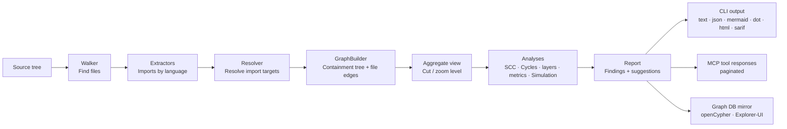
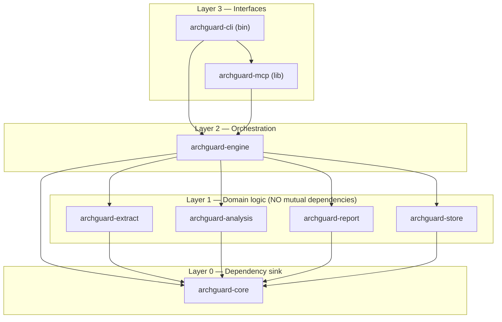

# ArchGuard — Architecture

[English](ARCHITECTURE.md) | [Deutsch](ARCHITECTURE_DE.md)

> Open-source CLI and MCP server for software architecture analysis: cycle
> detection, layer rules, coupling metrics and refactoring suggestions.
> Lightweight, language-independent and designed for AI agents.

Architecture foundations and implementation reference. Usage and limitations:
[README.md](README.md). License: MIT OR Apache-2.0.

---

## 1. Purpose and scope

**Goal:** A single, fast binary that

1. extracts a **hierarchical dependency graph** from a source tree (containment tree: system → modules → submodules → files),
2. calculates **cycles** (SCCs), **layer violations** and **coupling metrics** (Martin + Lakos: ACD/CCD/NCCD) at **every zoom level**,
3. supports **drill-down** from the system overview to individual import lines, in both a graph view and a dependency structure matrix (DSM),
4. suggests **specific edges to cut** and provides safe **simulation** ("what if I move X or cut this edge?"),
5. records **snapshots and trends** to track whether the architecture improves or deteriorates,
6. **works out of the box**: the first run requires no configuration; roots, languages, zoom depth and layers are inferred from the project. `archguard.toml` supplies corrections where necessary and promotes inferred guidance to CI gates (Section 11),
7. exposes all of this through a **CLI** (CI support and exit codes) and **MCP over stdio** (for AI agents).

Section 15 describes the feature set.

**Analysis boundaries:**

- No general cross-language semantic model or universal DIP/LSP verification. Java, C#, TypeScript/JavaScript and Go add compiler-backed evidence with explicit coverage limits.
- Imported runtime/build observations are separate from static source evidence; they do not make static dependencies a complete runtime graph.
- Line-based import scanners remain distinct from compiler helpers. A future tree-sitter backend can implement the `Extractor` trait.
- No native GUI: an embedded HTML viewer and local live server supplement exports.

---

## 2. Guiding principles

| Principle | Consequence |
| --- | --- |
| **Acyclic by construction** | A Cargo workspace with separate crates: Cargo forbids cyclic crate dependencies. A cycle is a *build error*, not a review question. CI also analyzes ArchGuard itself (Section 12). |
| **Dependency sink** | Shared types live in `archguard-core`, the lowest layer, which has no internal dependencies. Middle-layer crates **do not** depend on one another. |
| **Small-context-friendly** | Each crate is small and self-contained. A coding agent needs only its crate and the types from `archguard-core` for a task. MCP responses are paginated and summarized (Section 10.1) to fit small context windows. |
| **Summary first, drill-down by ID** | No tool call returns the entire graph. Start with a summary and IDs, then fetch details with `cycle_get` and `edge_evidence`. |
| **Inference instead of setup** | The first run needs no config: roots, languages, zoom depth and layers are inferred (Section 11). `archguard.toml` records corrections; inferred rules become CI gates only when written to the file ("promotion"). |
| **Deterministic** | Stable output sorting enables golden-file tests, reproducible baselines and diffable reports. |
| **Economical** | Rust, one static binary, no runtime or mandatory daemon. v1 is single-threaded for straightforward implementation by small models; `rayon` parallelism is a later, isolated optimization. The embedded graph database (Section 8) is an optional Cargo feature, keeping the slim binary small. |
| **The right tool for each task** | Hot-path algorithms run in memory on `petgraph`, a purpose-built graph library (µs–ms). An **embedded graph database** with openCypher and an explorer UI handles persistence, ad hoc queries and visualization (Section 8), using existing graph tooling. |

---

## 3. System overview

### 3.1 Analysis pipeline (data flow)



### 3.2 Crate graph (ArchGuard architecture: acyclic, four layers)



All arrows point downward. `archguard-mcp` is a library started by the CLI
through `archguard mcp`: one binary for both modes.

---

### 3.3 Review, source evidence and organizational context

The new analyses follow the same crate graph. Shared data types live in
`archguard-core`: `ReviewReport`/`ReviewSources`, `PerformanceReport`, declared
dependency/ownership rules and `ArchitectureContext`. Pure review computation
lives in `archguard-analysis/src/review.rs`. It receives the full graph, current
aggregation view and separately collected source evidence. The versioned score
and its limits are explained once in the
[review guide](README.md#common-workflows).

`archguard-engine` collects Git file touches, line counts, CODEOWNERS assignments,
co-change and performance indicators. Git runs with fixed process arguments,
without a shell. Missing, shallow or limited Git history remains visible in the
report; source paths, lines and changes are optional, never zeros inferred from
missing data. Package churn sums file touches. Co-change uses bounded pair/commit
searches and reports excluded bulk commits and cutoff limits. Ownership uses the
last matching supported rule and reports incomplete coverage.

`performance.rs` combines source indicators with graph reachability and the
existing `javac` scanner. The scanner provides type kind, abstractness, visibility
and direct supertypes. Main-sequence metrics require complete Java coverage;
SCC values aggregate types and boundary edges. Interface candidates come from
internal project calls and transitive supertypes with line evidence. The
Python/JS import heuristic remains a limited scanner, requiring no additional
parser or project build. The longest entry chain is calculated on the
SCC-condensed DAG. None of these analyses measures runtime or guarantees build
parallelism.

The HTML viewer receives optional `reviewContext`, `performance` and `insights`
data. `viewer_review.js` mirrors the pure review calculation for current
navigation and simulation; automated checks verify backend/frontend parity.
Original source identities continue linking virtual moves to their source
evidence. Performance, co-change and ownership remain labeled evidence from the
original report; the UI does not claim to rerun compiler/Git analysis after a
virtual operation. Older HTML payloads may omit context data. P1/P2 markers
supplement existing cycle/direction colors.

Explicit `dependency_rules` check source edges before view aggregation.
Ownership prohibitions and opt-in orphan findings feed the same `check` gate.
`check --base` analyzes a Git commit in a temporary directory with the same
current policy and module depth. New/resolved findings use content identities
rather than position-dependent display numbers. The relative ACD check accepts
only a Git base or snapshot with matching analysis scope, including project
filters/roots and module depth. Generated Markdown documentation is deterministic
and can be checked without writing files.

`ArchitectureContext` separates declared goals, constraints and decisions from
measured structure and findings. Missing intent is returned as a question; the
server does not invent organizational preferences. References remain data and
are not opened automatically. CLI and MCP use the same engine path. MCP responses
may be shortened by the response budget; CLI JSON reports include the selected
result lists, coverage and limits.

The shared review workflow lives in `archguard-engine/src/review_session.rs`.
It combines existing analyses and imports into a separate
`review_session::ReviewReport`; the existing `archguard-core::ReviewReport`
remains the structural priority report. Stable finding identities and evidence
fingerprints bind reasoned decisions to the analyzed state. Analysis and decision
revisions are checked again before import and recording. Individual project
files are written atomically; historical reviews use content-based filenames
without overwriting. CLI `review`, `viewer_assessment.js` and MCP `review_context`
use the same report. The viewer edits exportable drafts; MCP reads the saved
state with freshness checks and progressing 4-KiB pagination. Workflow, file
formats, gate effects and evidence limits are in the
[review guide](README.md#common-workflows).

## 4. Crate structure (Cargo workspace)

```text
archguard/
├── Cargo.toml                 # [workspace] members = crates/*
├── .archguard/archguard.toml      # ArchGuard architecture rules (self-analysis)
├── crates/
│   ├── archguard-core/           # L0: types, no internal logic dependency
│   ├── archguard-extract/        # L1: Walker, Extractor trait, scanners (Java, C#, Py, TS/JS, PHP, Rust), Resolver
│   ├── archguard-analysis/       # L1: SCC, cycles, metrics, layer rules, cut suggestions, baseline
│   ├── archguard-report/         # L1: Formatter (json, text, mermaid, dot, html, graphml, sarif)
│   ├── archguard-store/          # L1: GraphStore trait, Graph DB mirror (openCypher), query guard
│   ├── archguard-engine/         # L2: load config, orchestrate pipeline, graph cache
│   ├── archguard-mcp/            # L3: MCP server (stdio), tool registration
│   └── archguard-cli/            # L3: Binary `archguard`, clap commands
├── fixtures/                  # miniature test projects (ts-cyclic, py-layers, rs-clean)
└── .github/workflows/ci.yml   # fmt, clippy, test, self-analysis check
```

| Crate | Responsibility | External dependencies (deliberately minimal) |
| --- | --- | --- |
| `archguard-core` | `Node`, `Edge`, `Ref`, `Graph`, `GraphBuilder`, `Finding`, `Report`, `Config`, `ArchguardError` | `serde`, `serde_json`, `thiserror` |
| `archguard-extract` | `.gitignore`-aware file discovery, `Extractor` trait, Java/C#/Python/TS/JS/PHP/Rust scanners; two-stage resolution (path and declaration map/PSR-4) | `ignore`, `globset` |
| `archguard-analysis` | Tarjan SCC, bounded cycle enumeration, fan-in/out, instability, layer checks, **layer inference (ranking and name affinity)**, cut scoring, baseline diff | `petgraph` |
| `archguard-report` | Serialize `Report` types into all output formats | `serde_json` |
| `archguard-store` | `GraphStore` trait, DB mirror, read-only openCypher queries, query sanitizer | `kuzu = "=0.11.3"` (Ladybug/Kuzu lineage, only with Cargo feature `db`) |
| `archguard-engine` | `analyze(path, config) -> Report`, config parsing **and declared/derived/default resolution** (Section 11), caching, DB sync | `toml` |
| `archguard-mcp` | MCP tools, JSON schemas, pagination guard | `rmcp` (official MCP Rust SDK), `tokio` (only here), `schemars` |
| `archguard-cli` | Argument parsing, exit codes, format selection | `clap`, `anyhow` |

> `tokio`/async stays **exclusively** in `archguard-mcp`. The engine and lower
> layers are synchronous, keeping domain logic easy to test and implement.

---

## 5. Data model (in `archguard-core`, canonical JSON)

```jsonc
// Graph (schema_version for forward compatibility)
{
  "schema_version": 1,
  "root": "/abs/projekt",
  "nodes": [                                // containment tree using parent pointers
    { "id": 0, "name": "app",                     "kind": "module", "parent": null },
    { "id": 1, "name": "app/billing",             "kind": "module", "parent": 0 },
    { "id": 2, "name": "app/billing/invoice.ts",  "kind": "file",   "parent": 1, "lang": "ts" },
    { "id": 3, "name": "domain",                  "kind": "module", "parent": null },
    { "id": 4, "name": "domain/money.ts",         "kind": "file",   "parent": 3, "lang": "ts" }
  ],
  "edges": [                                // edges ONLY between file nodes
    { "from": 2, "to": 4,
      "refs": [                             // evidence: each concrete import site
        { "file": "src/app/billing/invoice.ts", "line": 4,
          "raw": "import { Money } from \"../../domain/money\";" }
      ] }
  ]
}
```

### 5.1 Containment hierarchy

The graph is **always extracted at file level**. A tree of `module` nodes with
`parent` pointers sits above it (system → modules → submodules → files). The
hierarchy source is **language-dependent** (Section 6.1):

- **Physical** (directory tree): TypeScript/JS, Python and Rust use the directory path as the module.
- **Logical** (package/namespace declaration): Java, C# and PHP use `package a.b;` or `namespace A.B;`, not the directory; these may differ in C#.

Node names are normalized module paths (`a/b/…`). Edges connect `file` nodes. If
a symbolic import cannot be assigned to a file (for example `import a.b.*` or a
C# namespace containing many files), its edge ends at the package's
**pseudo-file node `a/b/*`**, keeping aggregation uniform. Every coarser level
is produced by aggregation.

### 5.2 Views and zoom

A **view** is a *cut* through the tree: a set of visible nodes such that each file
node has exactly one visible ancestor (default depth: `modules.depth`).
`aggregate(graph, cut)` projects all file edges onto visible ancestors, sums
reference counts and retains an evidence sample, returning **another `Graph`**.

This is the central architectural mechanism: **all analyses (SCC, layers,
metrics, DSM and simulation) run unchanged at every zoom level**, because each
zoom level is simply a graph.

- **Zoom in** = `expand(node)`: replace the node in the cut with its children, allowing a module cycle to be expanded to the responsible files and import lines.
- **Zoom out** = `collapse(node)`: collapse children back into their parent.
- **Stateless:** clients (MCP agent, HTML viewer) send the expanded-node list; the server keeps no session.

```jsonc
// Finding (part of the report)
{
  "kind": "cycle",                          // "cycle" | "layer_violation" | "metric_threshold"
  "id": "scc-3",
  "severity": "error",                      // "error" | "warning" | "info"
  "nodes": ["app/billing", "domain/money", "app/tax"],
  "edge_count": 5,
  "cycles_sampled": 4,                      // bounded enumeration; see Section 7
  "suggested_cuts": [
    { "from": "domain/money", "to": "app/tax", "score": 0.91,
      "reason": "Only 1 import site; cutting breaks 4 of 4 cycles. Dependency inversion candidate: define an interface in domain and implement it in app/tax." }
  ]
}
```

```jsonc
// Report = result of a complete run
{
  "schema_version": 1,
  "summary": { "nodes": 142, "edges": 519, "sccs": 2, "largest_scc": 7,
               "layer_violations": 3, "status": "fail" },
  "config": { "project": "derived", "modules": "derived", "layers": "mixed",
              "rules": "default", "store": "default" },   // provenance by section:
                                                          // declared | derived | default | mixed (Section 11)
  "findings": [ /* Finding[] , stably sorted by severity, then id */ ],
  "metrics": { /* per module: fan_in, fan_out, instability, in_cycle */ }
}
```

**Rules:** IDs are internal integers (interned by `GraphBuilder`); external
identities are always names (source-root-relative paths). Edges are deduplicated
and their `refs` merged. Edges connect only `file` nodes. All lists are stably sorted.

---

## 6. Analysis pipeline (in `archguard-engine`)

1. **Load declarations:** read project config using the [file priority](README.md#configuration-and-project-data). Missing sections remain **empty**; defaults are not yet applied (resolution: `declared ⇐ derived ⇐ default`, Section 11).
2. **Infer project setup:** if `[project]` is absent, infer source roots and languages from manifests (PSR-4, `Cargo.toml`, tsconfig, pyproject) and extension statistics (Section 7, "Project inference"). `--no-derive` skips steps 2 and 7.
3. **Walk:** use the `ignore` crate (respecting `.gitignore`), filtering known extensions and `exclude` globs.
4. **Extract:** the scanner for each file yields imports (`RawImport` with `TargetSpec::Path` for relative paths or `TargetSpec::Symbol` for package/namespace imports) **and** declarations (the file's `package`/`namespace`).
5. **Resolve in two stages:** resolve path specs against the file tree and symbol specs against the **declaration map** (module path → declaring files, supplemented by PHP PSR-4 mappings from `composer.json`). A unique file gives a file edge; a known package gives a pseudo-node `package/*`; no match means external, a warning and no edge.
6. **Build the graph:** `GraphBuilder` creates each file node **and its directory ancestor chain** (`ensure_path`); edges are file → file only (interning, deduplication, discard self-edges).
7. **Complete config inference:** if `[modules].depth` is absent, choose depth for a target module count; infer `[[layers]]` rankings from the graph (Section 7, "Layer inference"), with declared entries overriding **by layer name**. This produces effective config; its provenance goes into `Report.config` (Section 11).
8. **Aggregate the view:** use a default cut at inferred or declared `modules.depth`, or `--level file` / `--expand …`. The view is itself a `Graph` (Section 5.2).
9. **Analyze:** SCC → bounded cycle sampling → layer check (declared ⇒ `Error`, derived ⇒ `Info`, Section 11) → metrics → cut suggestions → optional baseline diff / simulation. The display view does not change the configured gate level; file-cycle and metric gates are evaluated independently (contract in [README.md](README.md#configuration-and-project-data)).
10. **Produce the report** and return it to the interface (CLI formatter or MCP tool).
11. **Cache (optional):** CLI and MCP use `analyze_run` with the same effective config/provenance. The cache atomically stores graph, warnings and complete extraction identity; invalidation and safe file access are described in [README.md](README.md#configuration-and-project-data).
12. **DB sync (optional, `db` feature):** mirror graph and findings to `.archguard/graph.db` (Section 8) for Cypher queries and explorer visualization.

### 6.1 Import scanners and hierarchy

| Language | Hierarchy source | Captured imports | Resolution |
| --- | --- | --- | --- |
| **Java** | `package a.b;` (logical) | `import a.b.C;`, `import static`, `import a.b.*;` | Match class name within package; otherwise pseudo-node `a/b/*` |
| **C#** | `namespace A.B;` / `namespace A.B { }` (logical; may differ from directory) | `using A.B;`, `using static`, alias `using X = A.B.C;`, `global using` | Namespace pseudo-node `A/B/*`; unique file when possible |
| **Python** | Directory/file (physical, `__init__.py` packages) | `import a.b`, `from a.b import x`, relative `from . import y` | Absolute: module-path match (`a/b.py`, `a/b/__init__.py`); relative: path |
| **TypeScript/JS** | Directory (physical) | `import … from`, `export … from`, `require()`, dynamic `import()` | Relative paths (tsconfig path aliases: v1.1) |
| **PHP** | `namespace A\B;` plus PSR-4 from `composer.json` (logical) | `use A\B\C;` including grouped syntax and `use function/const`, `require`/`include` | PSR-4 → file; otherwise pseudo-node; `require` as path |
| **Rust** | Module tree (`mod`/file, physical) | `use crate::…`, `use super::…`, `mod x;` | Module-path match |

Go additionally uses module/package imports and a Go SDK parser/type helper.
Its semantic model includes packages, structs, interfaces and function groups,
with complexity and WMC measurements. Dynamic/external unresolved calls retain
partial coverage; DIT/NOC are not applicable. Compiler helpers for Java, C# and
TypeScript/JavaScript likewise supplement import evidence; the README documents
current coverage and requirements.

All scanners are line-based (roughly 100 lines per language, each an isolated
task), depend only on the `Extractor` trait and do not know one another. Adding
a language is a small new task, not a redesign.

---

## 7. Algorithms

| Problem | Method | Rationale |
| --- | --- | --- |
| Cycle detection | **Tarjan SCC** (`petgraph::algo::tarjan_scc`), O(V+E) | Standard, provided by petgraph, deterministic |
| Cycle enumeration | Root-bounded DFS **within** each SCC with edge, result and length budgets; `sampling` reports limits/completeness | Sample search remains bounded even when no short cycle is found; SCC detection remains independent |
| Cut suggestions | Greedy heuristic: per SCC edge, `score = (broken sampled cycles / total cycles) × 1/(1 + ln(ref_count))`; fewer import sites mean a cheaper cut | Approximates the minimum feedback arc set; each suggestion has an understandable explanation |
| Metrics | Fan-in (Ca), fan-out (Ce), instability `I = Ce/(Ca+Ce)`, cycle participation %, SCC size distribution | Classic Martin metrics, language-independent |
| Hierarchy aggregation | `aggregate(Graph, Cut) -> Graph`: project file edges onto visible ancestors and sum reference counts | Views are `Graph` instances, so **all** analyses run unchanged at every zoom level |
| ACD / CCD / NCCD | "Depends-upon" sets through reachability DFS; CCD = Σ, ACD = CCD/n, NCCD = CCD normalized against a binary tree | Lakos coupling measures, purely graph-based and language-independent |
| Simulation | Apply `SimOp { CutEdge, MoveNode, Merge }` to a graph copy, rerun analyses and diff findings/metrics. **SimOp JSON is the universal contract**: confirmed HTML viewer actions, CLI (`simulate --ops`) and agents (MCP `simulate`) produce and consume exactly the same format | Virtual refactoring lets agents and people inspect effects **before** changing code; one operation format for three interfaces |
| Layer checks | Map nodes to layers by name globs (`globset`); an edge is allowed iff its target layer belongs to the source layer's `may_depend_on` (direct edges only, no transitivity needed). Severity follows provenance: declared ⇒ `Error`, derived ⇒ `Info` (promotion, Section 11) | A straightforward rule model; inferred guidance never blocks CI |
| **Layer inference** | SCC condensation → longest-path ranking on the condensed DAG (`rank = 1 + max(dependency ranks)`, sinks = 0). A name-affinity table (`core\|domain\|model\|entity\|shared` at the bottom, `app\|service\|usecase\|logic\|feature` in the middle, `api\|ui\|cli\|web\|controller\|http` at the top) names ranks. Modules **in** SCCs cannot be ranked: an informational "cycle prevents layering" finding replaces layer violations | An initial zero-config hypothesis instead of layer boilerplate; cycles prevent layering |
| **Project inference** | Manifest inspection (`composer.json` PSR-4, `Cargo.toml`, `tsconfig.json`, `pyproject.toml`/`setup.py`, `pom.xml`) plus extension statistics over discovered files; declared values always win | Avoids the two common config mistakes, wrong root and wrong language, without requiring configuration |
| Baseline | Cycle hash = SHA-256 over sorted SCC node names; diff = new/removed hashes | Ratchet: tolerate existing cycles and block new ones |

---

## 8. Graph storage, queries and visualization

**Division of responsibilities:** analysis algorithms (Section 7) run **in memory
on `petgraph`**, a purpose-built Rust graph library. For 10³–10⁵ nodes this means
microseconds to milliseconds without I/O; a database on the hot path would add
overhead. For persistence, ad hoc queries and interactive visualization,
`archguard-store` mirrors the graph and analysis results into an **embedded graph
database**.

### 8.1 Backend: Ladybug/Kuzu lineage behind a trait

The selected **Kuzu lineage** provides an embedded, column-oriented, fast,
MIT-licensed openCypher database without a server process. Context: the original
Kuzu project was archived in October 2025 after its team joined Apple. The active
community successor is **[LadybugDB](https://ladybugdb.com/)**, a fork compatible
with the file format and Cypher.

Architectural consequences:

1. **Trait instead of direct dependency:** `archguard-store` defines `GraphStore { sync(graph, report), query(cypher, limit) }`. The backend can be replaced (Ladybug Rust SDK, CozoDB, …) without changing engine, CLI or MCP.
2. **v1 binding:** pinned `kuzu = "=0.11.3"` crate, the lineage's last release, file-compatible with Ladybug and explorer UIs. Migration to the Ladybug Rust SDK when available is an isolated store-crate task.
3. **Optional Cargo feature `db`:** the C++ backend increases build and binary size. The slim binary omits it; all analyses work, but `db` commands and `graph_query` are absent. Releases: `archguard` (slim) and `archguard-full`.
4. **Read-only external access:** CLI/MCP queries pass through a sanitizer allowing only `MATCH`/`RETURN` and enforcing `LIMIT`. Only `sync` can write.

### 8.2 DB schema

```cypher
CREATE NODE TABLE module(name STRING PRIMARY KEY, lang STRING, layer STRING,
                         fan_in INT64, fan_out INT64, instability DOUBLE, in_cycle BOOLEAN);
CREATE REL  TABLE depends_on(FROM module TO module, ref_count INT64, cyclic BOOLEAN);
CREATE NODE TABLE finding(id STRING PRIMARY KEY, kind STRING, severity STRING, detail STRING);
CREATE REL  TABLE involves(FROM finding TO module);
```

`sync` is idempotent: clear tables and refill them. Example queries for agents or people:

```cypher
// Which modules belong to a cycle?
MATCH (f:finding {kind: "cycle"})-[:involves]->(m:module) RETURN f.id, m.name;

// Hotspots: unstable AND in a cycle
MATCH (m:module) WHERE m.in_cycle AND m.instability > 0.7
RETURN m.name, m.fan_out ORDER BY m.fan_out DESC LIMIT 10;

// What depends transitively on domain/money? (variable-length path)
MATCH (a:module)-[:depends_on*1..4]->(b:module {name: "domain/money"})
RETURN DISTINCT a.name LIMIT 25;
```

### 8.3 Visualization options

| Option | Purpose | Setup |
| --- | --- | --- |
| `archguard graph --format mermaid\|dot` | Documentation, PR comments, READMEs | None: text output |
| `archguard graph --format html` | **Architecture dashboard** in one HTML file: explorer, graph/matrix and contextual inspector; explicit simulation with confirmed actions and JSON export. Browse clicks only inspect. Colors indicate cycle/simulation state; widths show full import counts. Usage and verification limits: [README.md](README.md) | Open the file |
| `archguard serve [PATH]` | Same viewer over a local HTTP server; browser polls update cached analysis, changed reports reload automatically. No static project-file sharing; see README | Open the URL |
| `archguard cycles --format html` | Same viewer, initially focused on cycles | Open the file |
| Kuzu/Ladybug Explorer web UI on `.archguard/graph.db` | Interactive Cypher exploration and graph rendering | Start a Docker container |
| [G.V()](https://gdotv.com/) on `.archguard/graph.db` | Graph IDE: query editor, layouts, debugging | Desktop app |
| `archguard graph --format graphml\|gexf` → Gephi Lite / yEd | Large graphs, layout algorithms, cluster analysis | Import the file |

---

## 9. CLI specification

One binary: `archguard`. Global flags: `--config <path>`, `--format text|json`
(default `text`), `--quiet`, `-v`, `--no-derive` (declared state and defaults only,
without inference, for reproducible comparisons).

The current command inventory and runnable examples are maintained in
[README.md](README.md).

**Exit codes:** `0` success · `1` violations found (`check`, `cycles --fail-on-found`)
· `2` usage error · `3` analysis error, such as an unreadable path.

CI example: `archguard check . --baseline --format sarif > archguard.sarif`

---

## 10. MCP specification

Transport: **stdio**, the standard for local agents. Register `archguard mcp
--root .` as the server command in your MCP client. The canonical server root
bounds all project, baseline and DB paths, including symlink targets. Relative
arguments resolve against this root, not the process working directory. Only CLI
calls may freely choose other projects. The SDK is `rmcp`, the official Model
Context Protocol Rust SDK. Each tool has a JSON schema (`schemars`) and a
**short description with examples**; descriptions form part of small agents'
prompts and are kept concise.

### 10.1 Small-context design rules

- Lists are truncated to a **4-KiB budget**; individual large texts may exceed it.
- Truncated responses carry `"truncated": true`; paginated tools also provide `"next_offset"`. Top-N tools have no generic offset pagination.
- No tool returns the raw graph; drill-down uses IDs.
- Scanning is implicit: each tool scans as needed with caching, so agents need not follow a prescribed call order.

### 10.2 Tool interface

The complete current tool list, count and response limits are in the
[README](README.md). Finding queries share `generate_review` with the CLI; they
neither introduce a second error classification nor save reviews or decisions.

### 10.3 Typical agent workflow

```text
Agent: architecture_findings { category: "architecture" }
                                         → current findings, stable IDs and revision
Agent: architecture_finding { finding_id: "<id>", expected_revision: "<revision>" }
                                         → source locations, edges, rules and follow-up queries
Agent: *follows next_offset with the same revision and reads change context*
Agent: *edits code and runs appropriate tests*
Agent: architecture_findings {}          → remaining and newly introduced findings
Agent: check {}                          → current gate status
```

---

## 11. Configuration (`archguard.toml`)

Default paths, legacy compatibility and analysis data storage are described in
[project conventions](README.md#configuration-and-project-data).

**Resolution: `declared ⇐ derived ⇐ default`.** Each value comes first from
`archguard.toml`, otherwise from the analyzed project, otherwise from its default.
A run therefore **always works without `archguard.toml`**. The file contains only
the *intent delta*: corrections to inference or inferred rules promoted to CI
gates. Per-section provenance appears in the report's `config` block (Section 5);
`archguard config` and MCP `config_view` distinguish intent from hypotheses.

| Section | Inference when not declared |
| --- | --- |
| `[project]` | Roots and languages from manifests (PSR-4, `Cargo.toml`, tsconfig, pyproject, pom) and extension statistics (Section 7); default `exclude` |
| `[modules].depth` | Depth targeting roughly 10–100 visible module nodes |
| `[[layers]]` | Longest-path ranking on the SCC-condensed graph plus name affinity (Section 7) |
| `[rules]` | **Cannot honestly be inferred**: thresholds express intent. `deny_cycles`/`max_scc_size` have safe defaults; other gates are off (`0`). `init` writes measured values as commented suggestions |
| `[store]` | Defaults: infrastructure only, nothing to infer |

**Layers: promotion instead of setup.** Fully inferred layers could *never*
report a violation by construction: a graph always conforms to itself.
Severity therefore follows provenance, not kind:

| Layer provenance | `LayerViolation` severity | `check` behavior |
| --- | --- | --- |
| Derived (absent from `archguard.toml`) | `Info` | Remains `pass`: structural guidance never blocks CI |
| Declared (`archguard.toml`) | `Error` | Blocks (`status: fail`, exit code 1) |

Modules **in** cycles cannot be ranked. They receive an informational
`layer_unranked` finding ("cycle prevents layering") instead of layer violations.

**Corrections by name:** a declared `[[layers]]` entry overrides the inferred
entry with the same name (`contains`, `may_depend_on`); additional declared
entries are added. `derive_layers = false` (top-level key, or `--no-derive`)
disables layer inference entirely, leaving only explicit configuration.

**Example — correction delta (the usual case, after the first run):**

```toml
derive_layers = true        # everything else stays inferred; record only corrections

[[layers]]
name = "core"               # inferred as "layer-0"; now promoted to an error gate
contains = ["core/**", "shared/**"]
may_depend_on = []

[rules]
deny_cycles = "module"
max_scc_size = 1
```

**Example — full configuration (`archguard init` writes inferred values for editing):**

```toml
derive_layers = true

[project]                   # derived from manifests and extension statistics
source_roots = ["src"]
exclude = ["**/tests/**", "**/*.spec.*", "**/generated/**"]   # default
languages = ["ts"]          # derived

[modules]
depth = 2                   # derived, targeting 10–100 visible nodes

[[layers]]                  # derived from dependency ranking and name affinity
name = "domain"
contains = ["domain/**"]
may_depend_on = []          # bottom layer, no outgoing edges

[[layers]]
name = "application"
contains = ["app/**"]
may_depend_on = ["domain"]

[[layers]]
name = "interface"
contains = ["api/**", "cli/**"]
may_depend_on = ["domain", "application"]

[rules]
deny_cycles = "module"      # intent (default)
max_scc_size = 1            # intent (default)
baseline = ".archguard/baseline.json"
# max_acd = 3.42                  # measured: 3.42; suggested gate from init (0 = off)
# max_instability_core = 0.05     # measured core instability; suggested gate (0 = off)

[store]                     # default
db = ".archguard/graph.db"
sync_on_check = false
```

> `archguard init` writes the **inferred state** and measured threshold
> suggestions, not boilerplate. Users reduce the file to their delta. This
> applies the baseline ratchet (Section 7) to configuration: accept the existing
> state and block deviations.

---

## 12. Safeguards for ArchGuard's architecture

1. **Cargo metadata allowlist:** `scripts/checks/check_architecture.py` checks the eight workspace crates and every manifest dependency against Section 3.2, including build, dev, optional and target-specific entries. Twelve edges are currently allowed and present. Cargo alone does not prevent forbidden acyclic layer edges.
2. **Dependency sink:** shared types belong only in `archguard-core`. L1 crates (`extract`, `analysis`, `report`, `store`) **never** import one another. Move a type needed by a higher layer into `core`; never add an upward or sideways edge.
3. **CI source scan:** `archguard check .` additionally runs with ArchGuard's own `archguard.toml`. The line-based Rust scanner does not resolve workspace sibling imports, so this scan does not replace the manifest allowlist.
4. **Change scope:** contributions stay within documented crate boundaries. New manifest dependencies are checked against the allowlist.

---

## 13. Testing strategy and CI

- **Unit tests** per crate: each task includes its tests as part of the definition of done.
- **Fixtures:** three hand-written miniature projects under `fixtures/`, around ten files each: `ts-cyclic/` (deliberate cycles), `py-layers/` (layer violation), `rs-clean/` (clean).
- **Golden-file tests:** compare `archguard check fixtures/ts-cyclic --format json` with committed expected JSON, enabled by deterministic sorting.
- **CLI integration tests:** `assert_cmd` and `insta` snapshots verify exit codes and text output.
- **CI (GitHub Actions):** reproducible slim/DB checks, viewer state tests, real CLI/MCP transport tests, architecture allowlist, source scan and weekly dependency checks. Commands: [ci.yml](.github/workflows/ci.yml); advisory decisions: [SECURITY.md](SECURITY.md).

---

## 14. Technology decisions and rationale

| Decision | Alternative | Rationale |
| --- | --- | --- |
| Rust | Go, Zig | One static binary, no GC, mature `petgraph`/`ignore`/`clap`/`rmcp`; meets the lightweight-framework requirement |
| Line-based scanners (v1) | tree-sitter | About 100 lines per scanner make small, isolated tasks; tree-sitter can later be added behind `Extractor` |
| `petgraph` rather than custom Tarjan | Custom implementation | Reuse an established implementation; the task becomes a small, low-risk graph↔petgraph mapping |
| Synchronous core, async only in MCP | Async throughout | Keeps domain logic simple and `tokio` out of lower layers |
| One binary with `mcp` subcommand | Two binaries | Easier distribution: `cargo install archguard`, Homebrew, one release artifact |
| Cycle **sampling** | Full Johnson enumeration | Predictable response size for context budgets and bounded runtime |
| Embedded graph DB (Ladybug/Kuzu lineage) as a mirror | Server-based graph database, CozoDB | No daemon, one file, openCypher and explorer/G.V() visualization. A trait, feature flag and pinned binding mitigate Kuzu's 2025 archival |
| In-memory analysis (`petgraph`), DB for exploration | All computation in DB | SCC/metrics are O(V+E) in memory, avoiding query-engine overhead; the DB serves ad hoc questions and visualization |
| Stateless zoom: clients send `expanded` | Per-client server sessions | Robust, concurrent, cacheable MCP server; the HTML viewer keeps its own zoom state |
| Containment hierarchy, views as aggregated graphs | Separate graph per level | One data model: every zoom level is a graph, so analyses/formatters need no level-specific cases |
| Config inference and promotion (`declared ⇐ derived ⇐ default`) | Fully manual configuration or inference alone | Manual boilerplate goes unmaintained; inference alone always conforms to itself. Provenance-based severity (derived ⇒ Info, declared ⇒ Error) combines zero-config use with real CI gates |
| Shared SimOps JSON contract (viewer actions, CLI `--ops`, MCP `simulate`) | Viewer that writes source directly, or CLI-only simulation | One format for mouse, person and agent. The tool never changes code; repairs remain intentional, consistent with promotion |

---

## 15. Feature set

ArchGuard combines dependency analysis, architecture rules and simulation through
the CLI, MCP and HTML viewer. The table maps features to their original rollout
stages; current status and analysis limits are in [README.md](README.md).

| Feature | Implementation | Stage |
| --- | --- | --- |
| Cycle detection and breakup suggestions | Tarjan SCC, cycle sampling, cut scoring with explanations | Implemented |
| Architecture rules (layers, components) | `archguard.toml` layer rules and layer **inference** with promotion (Section 11) | Implemented |
| Basic metrics (Martin: Ca/Ce/instability) | Incoming/outgoing coupling and instability from the dependency graph | Implemented |
| Hierarchical drill-down / zoom | Containment tree and views (Section 5.2): `graph_expand`, `--expand`, HTML viewer double-click zoom | Implemented |
| Cycle visualization | HTML cycle panel (isolate SCC, evidence tooltips), DSM markers, Mermaid/DOT export | Implemented |
| Dependency structure matrix (DSM) | `archguard dsm`, MCP `dsm`, viewer DSM tab | Implemented |
| Lakos metrics (ACD/CCD/NCCD) | Section 7, at every zoom level | Implemented |
| Virtual refactoring (simulation) | `archguard simulate` / MCP `simulate`: move/cut/merge, findings delta | Implemented |
| Trends / history | `snapshot`/`trend` and graph DB time series | Implemented |
| Quality gates | `[rules]` thresholds (`max_scc_size`, `max_acd`, …) and exit code | Implemented |
| Graph queries | openCypher through `graph_query`/`db query` | Implemented (`db` feature) |
| Symbol-level analysis and quality metrics | Java/C#/TypeScript/JavaScript/Go compiler helpers; scope and measurement rules in [README: Extended quality metrics](README.md#languages-and-source-metrics) | **Implemented, with explicit measurement coverage** |
| Duplicate detection | [CPD XML import](README.md#languages-and-source-metrics) with locations, source freshness and review findings; no built-in clone scanner | Implemented |
| Review metrics | Analysis payload `review_kpis` block: propagation cost, SDP, zones, tangledness, hub Gini, layer drift, debt density, API surface, leaks, risk gaps and health; definitions and limits below | **Implemented, with explicit measurement limits** |
| Decision register | `archguard review-decision` / MCP `review_decisions`; `.archguard/reviews.json`, atomic upsert by ID (format below) | Implemented |
| PR comment | `archguard review --format pr-comment --base <ref>` / MCP `pr_comment`; format below | Implemented |
| GUI application / IDE plugins | Deliberately excluded; standalone HTML viewer, DB explorer UI and G.V() instead | — |

### Review metrics and their limits

All values originate in pure `archguard-analysis` computations and
`archguard-extract` scanners; the engine aggregates them in
`archguard-engine/src/kpi_payload.rs`. Everywhere, `null` means "not measured",
never "clean" or zero.

- **Propagation cost** (`pc.rs`): for each cyclic SCC, its members plus all nodes reachable through original edges, divided by the view's node count. An acyclic view returns no entries: this records the state, not a measurement of 0. Edges to unknown node IDs are omitted. This measures static import reachability, not runtime behavior.
- **SDP violations** (`sdp.rs`): an edge A → B in the configured `[modules].depth` view where `I(B) > I(A)`, with `I = Fan-out / (Fan-in + Fan-out)` computed in `f32`. Missing endpoint metrics cause the edge to be skipped, never guessed. Equal instability is not a violation.
- **A/I zones** (`zones.rs`): classify by `D′ = |A + I − 1|` outside the ±1/3 corridor; `A + I < 1` is the Zone of Pain, `A + I > 1` the Zone of Uselessness. `A` requires compiler evidence. Boundaries without abstractness measurements remain `unmeasured`. The KPI block's `zones` remains `None` until an abstractness-metrics producer exists; the panel displays "not measured".
- **Tangledness** (`tangles.rs`): proportion of view nodes belonging to a cyclic SCC with more than one member.
- **Hub Gini** (`tangles.rs`): Gini coefficient of fan-in distribution plus the edge share of the five largest hubs (`top_share`). Without total reference counts in the graph, edge load is a sample lower bound and labeled accordingly.
- **Layer drift** (`layer_drift.rs`): deviation of inferred rankings from declared layers. Without declared layers, the value stays `None`; inferred layers do not establish a drift finding.
- **Debt density** (`debt.rs`): TODO/FIXME/HACK/XXX markers in comments per thousand lines. This uses a documented line heuristic, not a parser: a marker inside a string literal can match when the line opens a comment token. At 0 lines, `per_kloc` remains `null`.
- **Health index** (`health.rs`): weighted mean of normalized parts (`tangledness`, `hubs`, `sdp`, optionally `coverage`), score 0–100, green from 80 and yellow from 50. Weights come from `[review] health_weights`, with 1.0 for unconfigured parts. Parts without evidence are excluded; if no part has a positive finite weight, the score stays `None`. Trends require a previous snapshot.

The **decision register** is `.archguard/reviews.json`, formatted as
`ReviewRegister { version, decisions[] }`. Entries contain `id` (default: finding
ID), `finding_ref`, `decision` (`fix`/`defer`/`accept-risk`), `adr_link`, `note`,
`author` (CLI: `cli`, MCP: `mcp`) and ISO-8601 UTC `ts`. Recording the same ID again
replaces its entry (upsert by ID). Only the engine writes it
(`archguard-engine/src/review_register.rs`): serialize to a temporary file in the
same directory, then rename. A crash leaves no partially written register, and a
rejected body never reaches the writer. `accept-risk` without an ADR link triggers
the `[review]` gate `adr_required_on_accept_risk` (CLI: exit 2, MCP: Invalid Params).

The **PR comment** (`archguard-report/src/pr_comment.rs`) renders fixed sections:
`## Architektur-Review`, `### Zusammenfassung` (deltas for prioritized findings, cyclic
nodes, largest SCC, ACD and NCCD), `### Neue Befunde seit base`,
`### Behoben seit base` and `### Akzeptierte Risiken` (only `accept-risk` decisions,
sorted by finding ID, with `[ADR](…)` or `(kein ADR-Link)`). A finding is a report
entry with High or Medium priority, keyed by node name. The report has no
per-finding line numbers, so none are invented. All lists are sorted; repeated
runs produce identical Markdown.

The **dashboard payload** embeds `reviewKpis`, `reviewRegister`, `reviewHistory`
and `prComment` in the HTML report (`archguard-report/src/html.rs`). Each is
`null` when absent: no KPI block (for example, an older graph predating the KPI
pipeline), register, history or saved `pr-comment.md`. Panels then display "not
measured" rather than 0. The compatibility endpoint `GET /api/review-dashboard` exposes
`review_kpis` and `register` from a fresh run. KPI cards appear on Start;
Dashboard and Review are no longer separate viewer tabs. `POST /api/decisions` uses
the same atomic register writer as CLI and MCP.

---
