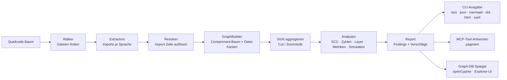
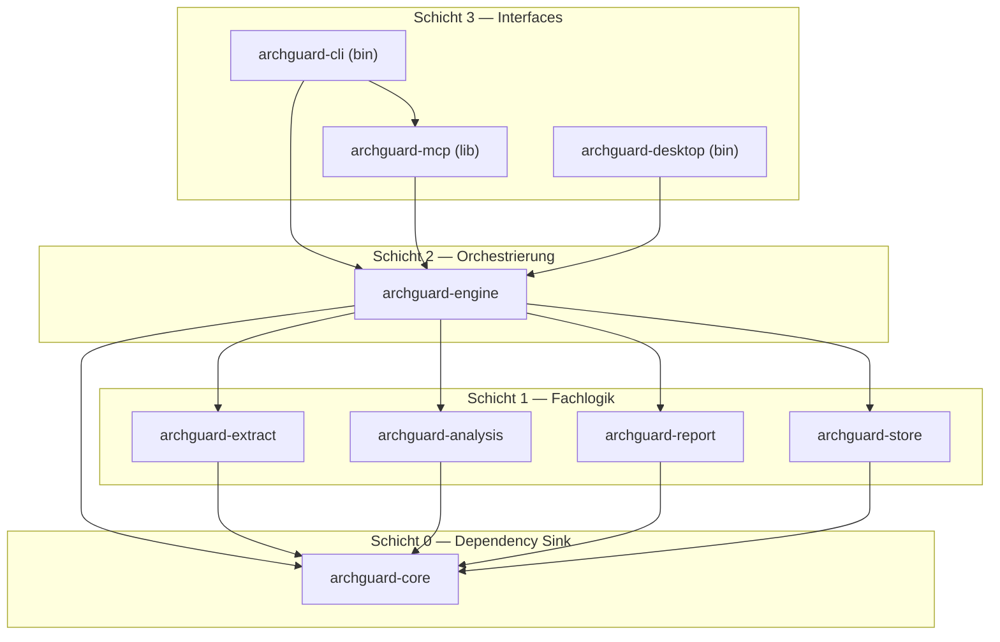

# ArchGuard — Architektur

[English](ARCHITECTURE.md) | [Deutsch](ARCHITECTURE_DE.md)

> Open-Source-CLI und MCP-Server zur Architekturanalyse: Zyklen,
> Schichtenregeln, Kopplungsmetriken und Refactoring-Vorschläge.

Architekturgrundlagen und Implementierungsreferenz. Bedienung und Grenzen:
[README_DE.md](README_DE.md). Lizenz: MIT OR Apache-2.0.

---

## 1. Ziel und Abgrenzung

**Ziel:** Ein einzelnes Binary, das

1. aus einem Quellcode-Baum einen **hierarchischen Abhängigkeitsgraphen** extrahiert (Containment-Baum: System → Module → Untermodule → Dateien),
2. darauf **Zyklen** (SCCs), **Schichtenverletzungen** und **Kopplungsmetriken** (Martin + Lakos: ACD/CCD/NCCD) berechnet — auf **jeder Zoomstufe**,
3. **Drill-down** bietet: vom Systemüberblick per Zoom-in bis zur einzelnen Import-Zeile, als Graph-Ansicht **und** als Dependency-Structure-Matrix (DSM),
4. **konkrete Vorschläge** liefert, welche Kanten man trennen sollte, und deren Wirkung per **Simulation** (Kante entfernen, Knoten verschieben, Knoten zusammenführen) ohne Codeänderung berechnet,
5. **Snapshots** speichert und Kennzahlen über Snapshots als Zeitreihe (`trend`) ausgibt,
6. **ohne Konfiguration läuft**: Wurzeln, Sprachen, Zoom-Tiefe und Schichten werden aus dem Projekt abgeleitet; `archguard.toml` überschreibt abgeleitete Werte und macht abgeleitete Regeln zu CI-Gates (Kap. 11),
7. das alles per **CLI** (CI-tauglich, Exit-Codes) und per **MCP über stdio** (für KI-Agenten) anbietet.

Den Funktionsumfang beschreibt Kap. 15.

**Analysegrenzen:**

- Kein allgemeines sprachübergreifendes semantisches Modell und keine universelle DIP-/LSP-Prüfung. Java, C#, TypeScript/JavaScript und Go ergänzen Compilerbelege mit expliziten Abdeckungsgrenzen.
- Importierte Laufzeit-/Build-Beobachtungen bleiben von statischen Quellbelegen getrennt. Statische Abhängigkeiten ergeben dadurch keinen vollständigen Laufzeitgraphen.
- Zeilenbasierte Importscanner bleiben von Compiler-Helpern getrennt. Ein zukünftiges tree-sitter-Backend kann den `Extractor`-Trait implementieren.
- Der eingebettete HTML-Viewer und der lokale Live-Server ergänzen die Exporte; ein nativer Desktop-Viewer (`archguard-desktop`, Slint) ist ein Prototyp, siehe [ADR 0002](docs/adr/0002-native-desktop-ui.md).

---

## 2. Leitprinzipien

| Prinzip | Konsequenz |
| --- | --- |
| **Azyklische Crates** | Cargo-Workspace mit getrennten Crates; Cargo lehnt zyklische Crate-Abhängigkeiten beim Build ab. Die erlaubten Kanten prüft zusätzlich `scripts/checks/check_architecture.py` in CI (Kap. 12). |
| **Dependency Sink** | Gemeinsame Typen liegen in `archguard-core` (Schicht 0, keine Workspace-Abhängigkeiten). Die Crates der Schicht 1 haben keine Abhängigkeiten untereinander. |
| **Begrenzte Antwortgröße** | MCP-Antworten sind auf ein 4-KiB-Budget gekürzt und paginiert (Kap. 10.1). |
| **Zusammenfassung, dann Details per ID** | Kein MCP-Tool liefert den vollständigen Graphen. Listen-Tools liefern IDs; Details liefern `cycle_get`, `edge_evidence` u. a. |
| **Ableitung vor Konfiguration** | Wurzeln, Sprachen, Zoom-Tiefe und Schichten werden abgeleitet (Kap. 11). `archguard.toml` enthält nur Abweichungen; eine abgeleitete Regel wird erst durch Eintrag in die Datei zum CI-Gate („Promotion"). |
| **Deterministisch** | Alle Ausgaben sind stabil sortiert. Voraussetzung für Golden-File-Tests, Baseline-Vergleiche und Report-Diffs. |
| **Ein Binary** | Rust, statisch gelinkt, kein Daemon. Die Analyse-Pipeline ist single-threaded; `rayon` wird nicht verwendet. Die Graph-DB (Kap. 8) ist das optionale Cargo-Feature `db`. |
| **Analyse in-memory, DB als Spiegel** | Graphalgorithmen laufen in-memory auf `petgraph`. Persistenz, Ad-hoc-Queries und Visualisierung laufen über eine embedded Graph-Datenbank mit openCypher (Kap. 8). |

---

## 3. Systemübersicht

### 3.1 Analyse-Pipeline (Datenfluss)



### 3.2 Crate-Graph



Jede Kante führt von einer höheren zu einer niedrigeren Schicht. Innerhalb von Schicht 1 gibt es
keine Kanten. Die dreizehn Kanten sind die vollständige Allowlist von
`scripts/checks/check_architecture.py` (Kap. 12). `archguard-mcp` ist eine Library; das Binary
`archguard` startet den MCP-Server über das Subkommando `archguard mcp`.

---

### 3.3 Review, Quellenbelege und organisatorischer Kontext

Gemeinsame Datentypen liegen in `archguard-core`: `ReviewReport`/`ReviewSources`, `PerformanceReport`, deklarierte
Abhängigkeits-/Ownership-Regeln und `ArchitectureContext`. Die reine
Review-Berechnung liegt in `archguard-analysis/src/review.rs`. Sie erhält einen
vollständigen Graphen, die aktuelle Aggregationssicht und separat erhobene
Quellenbelege. Der versionierte Score und seine Grenzen sind einmalig in der
[Review-Anleitung](README_DE.md#häufige-arbeitsabläufe) erklärt.

`archguard-engine` erhebt Git-Dateiberührungen, Zeilen, CODEOWNERS-Zuordnungen,
Co-Change und Performance-Hinweise. Git wird mit festen Prozessargumenten ohne
Shell gestartet. Fehlendes, flaches oder begrenztes Git bleibt im Report sichtbar;
Quellpfade, Zeilen und Änderungen sind optional, niemals aus fehlenden Daten
hergeleitete Nullen. Paket-Churn summiert Dateiberührungen. Co-Change nutzt
begrenzte Paar-/Commit-Suchen und gibt ausgeschlossene Sammelcommits sowie
Abbruchgrenzen an. Ownership wendet die letzte passende unterstützte Regel an;
unvollständige Abdeckung wird ausgewiesen.

`performance.rs` kombiniert Quellenhinweise mit Graphreichweite und dem
bestehenden `javac`-Scanner. Der Scanner liefert Typart, Abstraktheit, Sichtbarkeit
und direkte Supertypen. Main-Sequence-Metriken benötigen vollständige Java-Abdeckung;
SCC-Werte aggregieren Typen und Grenzkanten. Interface-Kandidaten werden aus
projektinternen Aufrufen und transitiven Supertypen mit Zeilenbelegen erzeugt.
Die Importheuristik für Python/JS bleibt ein begrenzter Scanner; kein zusätzlicher
Parser und kein Projektbuild ist dafür nötig. Die längste Einstiegskette wird auf
dem SCC-kondensierten DAG berechnet. Keine dieser Analysen misst Runtime oder
garantiert Build-Parallelisierbarkeit.

Der HTML-Viewer bekommt `reviewContext`, `performance` und `insights` als optionale
Daten. `viewer_review.js` spiegelt die reine Review-Berechnung für die aktuelle
Navigation und Simulation; Backend-/Frontend-Parität wird automatisiert geprüft.
Originale Quellidentitäten verbinden virtuelle Verschiebungen weiterhin mit ihren
Quellenbelegen. Performance, Co-Change und Ownership bleiben beschriftete Belege
des ursprünglichen Reports; die UI behauptet keine neue Compiler-/Git-Analyse
nach einer virtuellen Operation. Fehlende Kontextdaten älterer HTML-Payloads sind
zulässig. P1/P2-Marken ergänzen bestehende Zyklus-/Richtungsfarben.

Explizite `dependency_rules` prüfen Quellkanten vor der Ansichtsaggregation.
Ownership-Verbote und opt-in Orphan-Findings fließen in dasselbe `check`-Gate.
`check --base` analysiert einen Git-Commit in einem temporären Verzeichnis unter
derselben heutigen Policy und Modultiefe. Neue/aufgelöste Findings verwenden
inhaltliche Identitäten statt positionsabhängiger Anzeigenummern. Der relative
ACD-Check akzeptiert nur eine Git-Basis oder einen Snapshot mit passendem
Analysescope. Der Scope enthält Projektfilter/-wurzeln und Modultiefe. Die
generierte Markdown-Dokumentation ist deterministisch und read-only prüfbar.

`ArchitectureContext` trennt deklarierte Ziele, Constraints und Entscheidungen
von gemessener Struktur und Findings. Fehlender Intent wird als Frage geliefert;
der Server erfindet keine Organisationspräferenzen. Referenzen bleiben Daten und
werden nicht automatisch geöffnet. CLI und MCP verwenden denselben Engine-Pfad;
MCP-Antworten können durch das Antwortbudget gekürzt sein, die CLI-JSON-Reports
enthalten die ausgewählten Ergebnislisten mit Abdeckung und Grenzen.

Der gemeinsame Review-Arbeitsablauf liegt in
`archguard-engine/src/review_session.rs`. Er kombiniert vorhandene Analysen und
Importe zu einem separaten `review_session::ReviewReport`; das bestehende
`archguard-core::ReviewReport` bleibt der strukturelle Prioritätsreport. Stabile
Befundidentitäten und Belegfingerprints binden begründete Entscheidungen an den
analysierten Stand. Analyse- und Entscheidungsrevision werden vor Import und
Aufzeichnung erneut geprüft. Einzelne Projektdateien werden atomar geschrieben;
historische Reviews erhalten inhaltsbasierte Dateinamen ohne Überschreiben.
CLI `review`, `viewer_assessment.js` und MCP `review_context` verwenden denselben
Report. Der Viewer bearbeitet exportierbare Entwürfe, MCP liest den gespeicherten
Stand mit Aktualitätsprüfung und fortschreitender 4-KiB-Paginierung. Ablauf,
Dateiformate, Auswirkungen auf Gates und Beleggrenzen stehen in der
[Review-Anleitung](README_DE.md#häufige-arbeitsabläufe).

## 4. Crate-Struktur (Cargo-Workspace)

```text
archguard/
├── Cargo.toml                 # [workspace] members = crates/*
├── .archguard/archguard.toml      # Architekturregeln für dieses Repository
├── crates/
│   ├── archguard-core/           # L0: Typen, keine eigene Logik-Abhängigkeit
│   ├── archguard-extract/        # L1: Walker, Extractor-Trait, Scanner (Java, C#, Py, TS/JS, PHP, Rust, Go), Resolver
│   ├── archguard-analysis/       # L1: SCC, Zyklen, Metriken, Layer-Regeln, Cut-Vorschläge, Baseline
│   ├── archguard-report/         # L1: Formatter (json, text, mermaid, dot, html, graphml, sarif)
│   ├── archguard-store/          # L1: GraphStore-Trait, Graph-DB-Spiegel (openCypher), Query-Guard
│   ├── archguard-engine/         # L2: Config laden, Pipeline orchestrieren, Graph-Cache
│   ├── archguard-mcp/            # L3: MCP-Server (stdio), Tool-Registrierung
│   ├── archguard-cli/            # L3: Binary `archguard`, clap-Kommandos
│   └── archguard-desktop/        # L3: nativer Desktop-Viewer (Slint-Prototyp)
├── fixtures/                  # Testprojekte (ts-cyclic, py-layers, rs-clean, java-packages, …)
└── .github/workflows/ci.yml   # fmt, clippy, test, Architektur-Check
```

| Crate | Verantwortung | Externe Abhängigkeiten |
| --- | --- | --- |
| `archguard-core` | `Node`, `Edge`, `Ref`, `Graph`, `GraphBuilder`, `Finding`, `Report`, `Config`, `ArchguardError` | `serde`, `serde_json`, `thiserror` |
| `archguard-extract` | Dateisuche (`.gitignore`-aware), `Extractor`-Trait, Scanner für Java, C#, Python, TS/JS, PHP, Rust, Go; zweistufige Auflösung (Pfad + Deklarations-Map/PSR-4) | `ignore`, `globset`, `serde_json` |
| `archguard-analysis` | Tarjan-SCC, begrenzte Zyklen-Aufzählung, Fan-in/out, Instabilität, Layer-Check, **Layer-Ableitung (Ranking + Namensaffinität)**, Cut-Scoring, Baseline-Diff | `petgraph` |
| `archguard-report` | Serialisierung der `Report`-Typen in alle Ausgabeformate | `serde_json` |
| `archguard-store` | `GraphStore`-Trait, DB-Spiegel + read-only openCypher-Queries, Query-Sanitizer | `kuzu = "=0.11.3"` (Ladybug-/Kuzu-Lineage, nur hinter Cargo-Feature `db`) |
| `archguard-engine` | `analyze(path, config) -> Report`, Config-Parsing **+ Auflösung deklariert/abgeleitet/Default** (Kap. 11), Caching, DB-Sync | `toml` |
| `archguard-mcp` | MCP-Tools, JSON-Schemas, Pagination-Guard | `rmcp` (offizielles MCP-Rust-SDK), `tokio` (nur hier), `schemars` |
| `archguard-cli` | Argument-Parsing, Exit-Codes, Formatauswahl | `clap`, `anyhow` |
| `archguard-desktop` | Nativer Desktop-Viewer auf der Engine-API ([ADR 0002](docs/adr/0002-native-desktop-ui.md)) | `slint`, `rfd` |

`tokio` ist nur direkte Abhängigkeit von `archguard-mcp`. `archguard-engine` und die Schichten 0–1
sind synchron.

---

## 5. Datenmodell (in `archguard-core`, kanonisches JSON)

```jsonc
// Graph (schema_version für Vorwärtskompatibilität)
{
  "schema_version": 1,
  "root": "/abs/projekt",
  "nodes": [                                // Containment-Baum über parent-Zeiger
    { "id": 0, "name": "app",                     "kind": "module", "parent": null },
    { "id": 1, "name": "app/billing",             "kind": "module", "parent": 0 },
    { "id": 2, "name": "app/billing/invoice.ts",  "kind": "file",   "parent": 1, "lang": "ts" },
    { "id": 3, "name": "domain",                  "kind": "module", "parent": null },
    { "id": 4, "name": "domain/money.ts",         "kind": "file",   "parent": 3, "lang": "ts" }
  ],
  "edges": [                                // Kanten NUR zwischen file-Knoten
    { "from": 2, "to": 4,
      "refs": [                             // Belege: jede konkrete Import-Stelle
        { "file": "src/app/billing/invoice.ts", "line": 4,
          "raw": "import { Money } from \"../../domain/money\";" }
      ] }
  ]
}
```

### 5.1 Containment-Hierarchie

Der Graph wird **immer auf Dateiebene** extrahiert. Darüber liegt ein Baum aus `module`-Knoten
mit `parent`-Zeigern (System → Module → Untermodule → Dateien). Die Hierarchie-Quelle ist
**sprachabhängig** (Kap. 6.1):

- **physisch** (Verzeichnisbaum): TypeScript/JS, Python, Rust — der Ordnerpfad ist das Modul;
- **logisch** (Paket-/Namespace-Deklaration): Java, C#, PHP — maßgeblich ist `package a.b;`
  bzw. `namespace A.B;`, nicht der Ordner (bei C# können Namespace und Ordner voneinander abweichen).

Knotennamen sind normalisierte Modulpfade (`a/b/…`). Kanten verbinden `file`-Knoten; kann ein
symbolischer Import keiner Datei zugeordnet werden (z. B. `import a.b.*` oder ein C#-Namespace
mit vielen Dateien), endet die Kante auf dem **Pseudo-Dateiknoten `a/b/*`** des Pakets — so
bleibt die Aggregation einheitlich. Jede gröbere Ebene entsteht durch Aggregation.

### 5.2 Sichten & Zoom

Eine **Sicht** ist ein *Cut* durch den Baum: eine Menge sichtbarer Knoten, bei der jeder
Dateiknoten genau einen sichtbaren Vorfahren hat (Default: Tiefe aus `modules.depth`).
`aggregate(graph, cut)` projiziert alle Datei-Kanten auf die sichtbaren Vorfahren
(Ref-Counts summiert, Beleg-Stichprobe erhalten) — und liefert **wieder einen `Graph`**.

Da jede Sicht ein `Graph` ist, laufen SCC, Layer-Check, Metriken, DSM und Simulation auf jeder
Zoomstufe ohne ebenenspezifischen Code.

- **Zoom-in** = `expand(node)`: Knoten wird im Cut durch seine Kinder ersetzt; ein Modul-Zyklus
  lässt sich so bis auf die verursachenden Dateien und Import-Zeilen aufklappen.
- **Zoom-out** = `collapse(node)`: Kinder werden wieder zum Elternknoten zusammengefasst.
- **Zustandslos:** Clients (MCP-Agent, HTML-Viewer) senden die Liste expandierter Knoten mit;
  der Server hält keine Session.

```jsonc
// Finding (Teil des Reports)
{
  "kind": "cycle",                          // "cycle" | "layer_violation" | "metric_threshold"
  "id": "scc-3",
  "severity": "error",                      // "error" | "warning" | "info"
  "nodes": ["app/billing", "domain/money", "app/tax"],
  "edge_count": 5,
  "cycles_sampled": 4,                      // begrenzt aufgezählt, s. Kap. 7
  "suggested_cuts": [
    { "from": "domain/money", "to": "app/tax", "score": 0.91,
      "reason": "Nur 1 Import-Stelle; Trennen bricht 4 von 4 Zyklen. Kandidat für Dependency Inversion: Interface in domain definieren, app/tax implementiert es." }
  ]
}
```

```jsonc
// Report = Ergebnis eines kompletten Laufs
{
  "schema_version": 1,
  "summary": { "nodes": 142, "edges": 519, "sccs": 2, "largest_scc": 7,
               "layer_violations": 3, "status": "fail" },
  "config": { "project": "derived", "modules": "derived", "layers": "mixed",
              "rules": "default", "store": "default" },   // Provenienz je Abschnitt:
                                                          // declared | derived | default | mixed (Kap. 11)
  "findings": [ /* Finding[] , stabil sortiert nach severity, dann id */ ],
  "metrics": { /* je Modul: fan_in, fan_out, instability, in_cycle */ }
}
```

**Regeln:** IDs sind interne Integer (Interning im `GraphBuilder`), nach außen immer Namen
(source-root-relative Pfade). Kanten werden dedupliziert, `refs` dabei zusammengeführt;
Kanten nur zwischen `file`-Knoten. Alle Listen stabil sortiert.

---

## 6. Analyse-Pipeline (in `archguard-engine`)

1. **Deklaration laden:** die Projektconfig nach der [Dateipriorität](README_DE.md#konfiguration-und-projektdaten) lesen — nicht geschriebene Abschnitte und Werte erhalten ihren dokumentierten Default (Kap. 11); ein Abschnittskopf ohne Werte deklariert nichts. Auflösung: `deklariert ⇐ abgeleitet ⇐ Default`.
2. **Vorarbeit ableiten:** `[project]` nicht deklariert → Source-Roots + Sprachen aus Manifesten (PSR-4, `Cargo.toml`, tsconfig, pyproject) und Endungs-Statistik (Kap. 7, „Projekt-Ableitung").
3. **Walken:** `ignore`-Crate (respektiert `.gitignore`), Filter nach bekannten Endungen + `exclude`-Globs.
4. **Extrahieren:** je Datei der passende Scanner → Importe (`RawImport` mit `TargetSpec::Path` für relative Pfade oder `TargetSpec::Symbol` für Paket-/Namespace-Importe) **und** Deklarationen (`package`/`namespace` der Datei).
5. **Auflösen (zweistufig):** Pfad-Specs gegen den Dateibaum; Symbol-Specs gegen die **Deklarations-Map** (Modulpfad → deklarierende Dateien, bei PHP ergänzt um das PSR-4-Mapping aus `composer.json`). Eindeutige Datei → Datei-Kante; nur Paket bekannt → Pseudoknoten `paket/*`; nichts gefunden → extern, Warnung, keine Kante.
6. **Graph bauen:** `GraphBuilder` legt je Datei den Knoten **samt Verzeichnis-Vorfahrenkette** an (`ensure_path`); Kanten nur Datei → Datei (Interning, Dedup, Selbstkanten verwerfen).
7. **Config fertig ableiten:** `[modules].depth` fehlt → Depth mit Ziel-Modulzahl wählen; `[[layers]]` → Ranking aus dem Graphen ableiten (Kap. 7, „Layer-Ableitung"), deklarierte Einträge überschreiben **pro Layer-Name**. Hier entsteht die Effective Config, ihre Provenienz wandert in `Report.config` (Kap. 11).
8. **Sicht aggregieren:** Default-Cut bei (abgeleiteter oder deklarierter) `modules.depth` (oder `--level file`, `--expand …`); die Sicht ist selbst ein `Graph` (Kap. 5.2).
9. **Analysieren:** SCC → begrenztes Zyklen-Sampling → Layer-Check (deklariert ⇒ `Error`, abgeleitet ⇒ `Info`, Kap. 11) → Metriken → Cut-Vorschläge → optional Baseline-Diff / Simulation. Die Darstellungssicht ändert nicht die konfigurierte Gate-Ebene; Datei-Zyklus-Gates und Metrik-Gates werden unabhängig ausgewertet (Vertrag in [README.md](README_DE.md#konfiguration-und-projektdaten)).
10. **Report erzeugen** und an Interface (CLI-Formatter oder MCP-Tool) zurückgeben.
11. **Cache (optional):** CLI und MCP nutzen `analyze_run` mit derselben effektiven Config/Provenienz. Der Cache speichert Graph, Warnungen und vollständige Extraktionsidentität atomar; Details zu Invalidierung und sicheren Dateizugriffen stehen in [README.md](README_DE.md#konfiguration-und-projektdaten).
12. **DB-Sync (optional, Feature `db`):** Graph + Findings nach `.archguard/graph.db` spiegeln (Kap. 8) — für Cypher-Queries und Explorer-Visualisierung.

### 6.1 Importscanner und Hierarchie

| Sprache | Hierarchie-Quelle | Erfasste Importe | Auflösung |
| --- | --- | --- | --- |
| **Java** | `package a.b;` (logisch) | `import a.b.C;`, `import static`, `import a.b.*;`, qualifizierte Namen `com.a.B` im Code | Datei per Klassennamen-Match im Paket; sonst Pseudoknoten `a/b/*`; qualifizierte Namen nur zu einer Typdatei eines deklarierten Pakets |
| **Kotlin** | `package a.b` (logisch, gemeinsam mit Java) | `import a.b.C`, `import a.b.C as D`, `import a.b.*`, qualifizierte Namen `com.a.B` im Code; `kotlin.*`/`kotlinx.*`/`java.*`/`javax.*` ignoriert | Wie Java, gegen Java- und Kotlin-Dateien; eine Top-Level-Funktion ohne gleichnamige Datei endet am Paket-Pseudoknoten |
| **C#** | `namespace A.B;` / `namespace A.B { }` (logisch — Datei ≠ Verzeichnis möglich) | `using A.B;`, `using static`, Alias-`using X = A.B.C;`, `global using`, qualifizierte Namen `A.B.C` im Code | Namespace-Ebene (Pseudoknoten `A/B/*`); eindeutige Datei, wenn möglich; qualifizierte Namen nur zu einer Typdatei eines deklarierten Namespace |
| **Python** | Verzeichnis/Datei (physisch, `__init__.py`-Pakete) | `import a.b`, `from a.b import x`, relative `from . import y` | absolut: Modulpfad-Match (`a/b.py`, `a/b/__init__.py`); relativ: Pfad |
| **TypeScript/JS** | Verzeichnis (physisch) | `import … from`, `export … from`, `require()`, dyn. `import()` | relative Pfade (tsconfig-paths-Aliase: v1.1) |
| **PHP** | `namespace A\B;` + PSR-4-Mapping aus `composer.json` (logisch) | `use A\B\C;` (auch Gruppen-Syntax, `use function/const`), `require`/`include`, voll qualifizierte Namen `\A\B\C` im Code | PSR-4 → Datei; sonst Pseudoknoten; `require` als Pfad |
| **Rust** | Modulbaum (`mod`/Datei, physisch) | `use crate::…`, `use super::…`, `mod x;`, Pfade im Code wie `crate::a::B::new()` | Modulpfad-Match; Workspace-Crates über lokale `Cargo.toml`-Abhängigkeiten |

Python ergänzt einen reinen Syntax-Helfer auf dem Standardmodul `ast` (`archguard-engine/src/python_calls.rs`), gestartet mit `-I -S`; die Zählregeln entsprechen dem Rust-Syntaxanalyzer. PHP nutzt mit denselben Regeln den Token-Scanner `archguard-extract/src/php_structure.rs` und braucht keine PHP-Installation. Rust-Aufrufziele stammen nach `ARCHGUARD_TRUST_PROJECT_COMPILER=1` aus `rust-analyzer scip` (`archguard-engine/src/rust_scip.rs`), mit ersetztem Build-Skript-Befehl, sodass kein Projektcode läuft; SCIP benennt jedes Symbol, die `syn`-Aufrufstellen bestimmen, was ein Aufruf ist.

Go ergänzt Modul-/Paketimporte mit einem Parser-/Typ-Helper des Go SDK.
Das semantische Modell enthält Pakete, Structs, Interfaces und Funktionsgruppen
sowie Komplexität und WMC. Dynamische/externe unaufgelöste Aufrufe behalten
partielle Abdeckung; DIT/NOC sind nicht anwendbar. Auch Java, C# und
TypeScript/JavaScript ergänzen Importbelege durch Compiler-Helper. Die README
beschreibt den aktuellen Umfang und die Voraussetzungen.

Die Scanner in `archguard-extract` sind zeilenbasiert mit lexikalischer Abschirmung und
implementieren den `Extractor`-Trait (`archguard-extract/src/extract.rs`). `registry()` registriert
sie; Scanner importieren einander nicht. Eine neue Sprache erfordert einen neuen Scanner und einen
Eintrag in `registry()`. Rust-Importkanten liefert der `syn`-basierte Resolver in
`archguard-engine/src/rust_imports.rs`; er verknüpft auch Pfade im Code und Importe lokaler
Workspace-Crates.

---

## 7. Algorithmen

| Problem | Verfahren | Begründung |
| --- | --- | --- |
| Zyklenerkennung | **Tarjan SCC** (`petgraph::algo::tarjan_scc`), O(V+E) | Implementierung aus `petgraph` |
| Zyklen aufzählen | Wurzelbegrenzte DFS **innerhalb** jeder SCC mit Kanten-, Ergebnis- und Längenbudget; `sampling` weist Grenzen/Vollständigkeit aus | Beispielsuche bleibt begrenzt, auch ohne kurzen gefundenen Zyklus; SCC-Erkennung bleibt unabhängig |
| Cut-Vorschläge | Greedy-Heuristik: pro SCC-Kante `score = (gebrochene Sample-Zyklen / Zyklen gesamt) × 1/(1 + ln(ref_count))` ; weniger Import-Stellen ergeben einen höheren Score | Heuristik für das NP-schwere Minimum-Feedback-Arc-Set; jeder Vorschlag enthält Score und Begründungstext |
| Metriken | Fan-in (Ca), Fan-out (Ce), Instabilität `I = Ce/(Ca+Ce)`, Zyklus-Beteiligung %, SCC-Größenverteilung | Martin-Metriken; nur aus Graphkanten berechnet |
| Hierarchie-Aggregation | `aggregate(Graph, Cut) -> Graph`: Datei-Kanten auf sichtbare Vorfahren projizieren, Ref-Counts summieren | Sichten sind `Graph`-Instanzen; alle Analysen laufen auf jeder Zoomstufe |
| ACD / CCD / NCCD | „Depends-Upon"-Mengen per Erreichbarkeits-DFS; CCD = Σ, ACD = CCD/n, NCCD = CCD normiert auf Binärbaum | Lakos-Kopplungsmaße; nur aus Graphkanten berechnet |
| Simulation | `SimOp { CutEdge, MoveNode, Merge }` auf Kopie des Graphen anwenden, Analysen neu laufen lassen, Findings/Metriken diffen. **SimOp-JSON ist der universelle Vertrag**: bestätigte Aktionen im HTML-Viewer, CLI (`simulate --ops`) und Agent (MCP `simulate`) erzeugen und konsumieren exakt dasselbe Format | Wirkung einer Strukturänderung wird vor der Codeänderung berechnet; ein Format für Viewer, CLI und MCP |
| Layer-Check | Knoten → Layer via Glob auf den Namen (`globset`); Kante erlaubt ⇔ Ziel-Layer ∈ `may_depend_on` des Quell-Layers (transitiv nicht nötig, nur direkte Kanten); Severity nach Ursprung: deklariert ⇒ `Error`, abgeleitet ⇒ `Info` (Promotion, Kap. 11) | Nur direkte Kanten werden geprüft; abgeleitete Layer lassen `check` nicht fehlschlagen |
| **Layer-Ableitung** | SCC-Kondensation → Longest-Path-Ranking auf dem kondensierten DAG (`rank = 1 + max(rank der Abhängigkeiten)`, Senken = 0); Namensaffinitäts-Tabelle (`core\|domain\|model\|entity\|shared` unten, `app\|service\|usecase\|logic\|feature` Mitte, `api\|ui\|cli\|web\|controller\|http` oben) benennt die Ränge; Module **in** SCCs sind nicht rankbar → Info-Finding „Zyklus verhindert Schichtung" statt Layer-Verletzung | Liefert Layer ohne Konfiguration; ein Longest-Path-Ranking ist nur auf einem DAG definiert |
| **Projekt-Ableitung** | Manifest-Sniffing (`composer.json` PSR-4, `Cargo.toml`, `tsconfig.json`, `pyproject.toml`/`setup.py`, `pom.xml`) + Endungs-Statistik über die gewalkten Dateien; deklarierte Werte gewinnen immer | Source-Roots und Sprachen ohne `[project]`-Abschnitt |
| Baseline | Zyklus-Hash = SHA-256 über sortierte Knotennamen der SCC; Diff = neue/entfernte Hashes | Zyklen der Baseline werden toleriert; neue Zyklus-Hashes lassen `check` fehlschlagen |

---

## 8. Graph-Storage, Query & Visualisierung

Die Analyse-Algorithmen (Kap. 7) laufen in-memory auf `petgraph` und lesen nicht aus der Datenbank. `archguard-store` spiegelt Graph und Analyseergebnisse in eine embedded Graph-Datenbank für Persistenz, Ad-hoc-Queries und Visualisierung.

### 8.1 Backend: Ladybug/Kuzu-Lineage hinter einem Trait

Backend ist die **Kuzu-Lineage** (embedded, spaltenorientiert, openCypher, MIT-Lizenz, kein Server-Prozess). Das Kuzu-Projekt wurde im Oktober 2025 archiviert. **[LadybugDB](https://ladybugdb.com/)** ist ein Fork mit kompatiblem Dateiformat und Cypher-Dialekt.

Umsetzung:

1. **Trait statt Direktabhängigkeit:** `archguard-store` definiert `GraphStore { sync(graph, report), query(cypher, limit) }`. Das DB-Backend ist dahinter austauschbar (Ladybug-Rust-SDK, CozoDB, …), ohne dass Engine, CLI oder MCP sich ändern.
2. **v1-Binding:** gepinntes `kuzu = "=0.11.3"`-Crate (letztes Release der Lineage, dateikompatibel mit Ladybug und den Explorer-UIs). Migration auf das Ladybug-Rust-SDK, sobald verfügbar, ist ein isolierter Task im Store-Crate.
3. **Optionales Cargo-Feature `db`:** Das C++-Backend vergrößert Build-Zeit und Binary. Ohne `db` fehlen nur die `db`-Kommandos und `graph_query`; alle Analysen sind enthalten. Release-Archive enthalten den Build ohne `db` ([RELEASES.md](RELEASES.md)); `cargo build -p archguard-cli --features db` fügt es hinzu.
4. **Read-only nach außen:** Query-Zugang (CLI/MCP) läuft durch einen Sanitizer — nur `MATCH`/`RETURN`, erzwungenes `LIMIT`. Schreiben kann ausschließlich `sync`.

### 8.2 DB-Schema

```cypher
CREATE NODE TABLE module(name STRING PRIMARY KEY, lang STRING, layer STRING,
                         fan_in INT64, fan_out INT64, instability DOUBLE, in_cycle BOOLEAN);
CREATE REL  TABLE depends_on(FROM module TO module, ref_count INT64, cyclic BOOLEAN);
CREATE NODE TABLE finding(id STRING PRIMARY KEY, kind STRING, severity STRING, detail STRING);
CREATE REL  TABLE involves(FROM finding TO module);
```

`sync` ist idempotent (Tabellen leeren, neu befüllen). Beispiel-Queries:

```cypher
// Welche Module hängen an einem Zyklus?
MATCH (f:finding {kind: "cycle"})-[:involves]->(m:module) RETURN f.id, m.name;

// Hotspots: instabil UND im Zyklus
MATCH (m:module) WHERE m.in_cycle AND m.instability > 0.7
RETURN m.name, m.fan_out ORDER BY m.fan_out DESC LIMIT 10;

// Wer hängt transitiv an domain/money? (variable-length path)
MATCH (a:module)-[:depends_on*1..4]->(b:module {name: "domain/money"})
RETURN DISTINCT a.name LIMIT 25;
```

### 8.3 Visualisierungswege

| Weg | Wofür | Aufwand |
| --- | --- | --- |
| `archguard graph --format mermaid\|dot` | Doku, PR-Kommentare, READMEs | keiner (Textausgabe) |
| `archguard graph --format html` | **Architektur-Dashboard** als eine HTML-Datei: Explorer, Graph/Matrix und kontextbezogener Inspektor; explizite Simulation mit bestätigten Aktionen und JSON-Export. Browse-Klicks inspizieren nur. Farben kennzeichnen Zyklus-/Simulationsstatus, Breiten die vollständigen Importzahlen. Bedienung und Prüfgrenzen: [README_DE.md](README_DE.md#mit-einem-projekt-starten) | keiner (Datei öffnen) |
| `archguard serve [PATH]` | Derselbe Viewer über lokalen HTTP-Server; gecachte Analyse wird auf Browser-Polls aktualisiert, geänderte Berichte laden automatisch neu. Keine statische Freigabe von Projektdateien; Details in README | URL öffnen |
| `archguard cycles --format html` | Gleicher Viewer, startet mit Fokus auf Zyklen | keiner (Datei öffnen) |
| Explorer-Web-UI (Kuzu/Ladybug Explorer) direkt auf `.archguard/graph.db` | Interaktive Cypher-Exploration mit Graph-Rendering | Docker-Container starten |
| [G.V()](https://gdotv.com/) auf `.archguard/graph.db` | Graph-IDE: Query-Editor, Layouts, Debugging | Desktop-App |
| `archguard graph --format graphml\|gexf` → Gephi Lite / yEd | Große Graphen, Layout-Algorithmen, Cluster-Analysen | Import-Klick |

---

## 9. CLI-Spezifikation

Ein Binary: `archguard`. Globale Flags: `--config <pfad>`, `--format` (Default `text`), `--quiet`, `-v`. Für reproduzierbare Vergleiche ohne Layer-Ableitung `derive_layers = false` in der Config setzen.

Der Befehlskatalog steht in [site/docs/cli.html](site/docs/cli.html) (englisch);
die häufigen Befehle stehen in [README_DE.md](README_DE.md#häufige-arbeitsabläufe).
`archguard --help` und `archguard <befehl> --help` zeigen die genauen Argumente.

**Exit-Codes:** `0` ok · `1` Verletzungen gefunden (`check`, `cycles --fail-on-found`) · `2` Bedienfehler · `3` Analysefehler (z. B. Pfad nicht lesbar).

Beispiel CI: `archguard check . --baseline --format sarif > archguard.sarif`

---

## 10. MCP-Spezifikation

Transport: **stdio** (Standard für lokale Agenten; Registrierung z. B. `claude mcp add archguard -- archguard mcp --root .`).
Die kanonische Server-Root begrenzt alle Projekt-, Baseline- und DB-Pfade einschließlich Symlink-Zielen; relative Argumente beziehen sich auf diese Root, nicht das Prozess-CWD. Nur CLI-Aufrufe dürfen frei andere Projekte wählen.
SDK: `rmcp` (offizielles Rust-SDK des Model Context Protocol). Jedes Tool hat ein JSON-Schema (`schemars`) und eine Beschreibung mit Beispiel. Tool-Beschreibungen werden in den Kontext des Agenten geladen und sind deshalb kurz.

### 10.1 Antwortgrenzen

- Listen werden mit einem **4-KiB-Budget** gekürzt; große Einzeltexte können das Budget überschreiten.
- Abgeschnittene Antworten tragen `"truncated": true`; paginierte Tools bieten zusätzlich `"next_offset"`. Top-N-Tools haben keine generische Offset-Paginierung.
- Kein Tool liefert den Rohgraphen; Drill-down läuft über IDs.
- Jedes Tool scannt bei Bedarf selbst (mit Cache); es gibt keine vorgeschriebene Aufrufreihenfolge.

### 10.2 Tool-Schnittstelle

Der Server meldet seine aktuellen Tools mit Schemas über MCP `tools/list`;
die Definitionen liegen in `crates/archguard-mcp/src/`. Antwortgrenzen stehen
in Kap. 10.1. Die Befundabfragen verwenden
`generate_review` als gemeinsame Engine mit der CLI; sie erzeugen keine zweite
Fehlerklassifikation und speichern weder Reviews noch Entscheidungen.

### 10.3 Typischer Agenten-Workflow

```text
Agent: architecture_findings { category: "architecture" }
                                         → aktuelle Befunde, stabile IDs und Revision
Agent: architecture_finding { finding_id: "<id>", expected_revision: "<revision>" }
                                         → Quellstellen, Kanten, Regeln und Folgeabfragen
Agent: *folgt next_offset mit derselben Revision, liest den Änderungskontext*
Agent: *editiert Code und führt passende Tests aus*
Agent: architecture_findings {}          → verbleibende und neu entstandene Befunde
Agent: check {}                          → aktueller Gate-Status
```

---

## 11. Konfiguration (`archguard.toml`)

Standardpfad, Legacy-Kompatibilität und Ablage der Analysedaten stehen im
[Projektstandard](README_DE.md#konfiguration-und-projektdaten).

**Auflösung: `deklariert ⇐ abgeleitet ⇐ Default`.** Jeder Wert kommt der Reihe nach aus `archguard.toml`,
sonst aus dem analysierten Projekt, sonst aus dem Default. Ein Lauf benötigt keine `archguard.toml`. Die Datei
enthält nur Abweichungen von der Ableitung und abgeleitete Regeln, die als CI-Gate gelten sollen. Die Provenienz je Abschnitt landet im
Report (`config`-Block, Kap. 5); `archguard config` und MCP `config_view` zeigen je Wert, ob er deklariert,
abgeleitet oder Default ist.

| Abschnitt | Ableitung, falls nicht deklariert |
| --- | --- |
| `[project]` | Roots + Sprachen per Manifest-Sniffing (PSR-4, `Cargo.toml`, tsconfig, pyproject, pom) und Endungs-Statistik (Kap. 7); `exclude`: Defaults |
| `[modules].depth` | Depth mit Ziel ~10–100 sichtbarer Modul-Knoten |
| `[[layers]]` | Longest-Path-Ranking auf dem SCC-kondensierten Graphen + Namensaffinität (Kap. 7) |
| `[rules]` | nicht abgeleitet: `deny_cycles`/`max_scc_size` haben Defaults, alle weiteren Gates sind aus (`0`); `init` schreibt gemessene Werte als auskommentierte Vorschläge |
| `[store]` | Defaults |

**Layer-Severity.** Aus einem Graphen abgeleitete Layer erzeugen auf demselben Graphen keine
Verletzung. Die Severity einer `LayerViolation` hängt daher vom Ursprung der Layer-Definition ab:

| Layer-Ursprung | Severity der `LayerViolation` | Verhalten von `check` |
| --- | --- | --- |
| abgeleitet (nicht in `archguard.toml`) | `Info` | bleibt `pass` |
| deklariert (`archguard.toml`) | `Error` | blockiert (`status: fail`, Exit-Code 1) |

Module **in** Zyklen sind nicht rankbar → ein Info-Finding `layer_unranked` („Zyklus verhindert
Schichtung") statt Layer-Verletzungen.

**Korrektur pro Name:** ein deklarierter `[[layers]]`-Eintrag überschreibt den abgeleiteten
gleichen Namens (`contains`, `may_depend_on`); weitere deklarierte kommen hinzu.
`derive_layers = false` (Top-Level-Key) schaltet die Layer-Ableitung
komplett ab — dann gilt ausschließlich das Geschriebene.

**Beispiel — nur Abweichungen deklariert:**

```toml
derive_layers = true        # nicht deklarierte Layer werden abgeleitet

[[layers]]
name = "core"               # abgeleitet als "layer-0"; deklariert ⇒ Verletzungen haben Severity Error
contains = ["core/**", "shared/**"]
may_depend_on = []

[rules]
deny_cycles = "module"
max_scc_size = 1
```

**Beispiel — von `archguard init` erzeugte Datei:**

```toml
derive_layers = true

[project]                   # abgeleitet (Manifest-Sniffing + Endungs-Statistik)
source_roots = ["src"]
exclude = ["**/tests/**", "**/*.spec.*", "**/generated/**"]   # Default
languages = ["ts"]          # abgeleitet

[modules]
depth = 2                   # abgeleitet (Ziel: 10–100 Sicht-Knoten)

[[layers]]                  # abgeleitet: Dependency-Ranking + Namensaffinität
name = "domain"
contains = ["domain/**"]
may_depend_on = []          # unterste Schicht (keine ausgehenden Kanten)

[[layers]]
name = "application"
contains = ["app/**"]
may_depend_on = ["domain"]

[[layers]]
name = "interface"
contains = ["api/**", "cli/**"]
may_depend_on = ["domain", "application"]

[rules]
deny_cycles = "module"      # Intent (Default)
max_scc_size = 1            # Intent (Default)
baseline = ".archguard/baseline.json"
# max_acd = 3.42                  # gemessen: 3.42 — Gate-Vorschlag von init (0 = aus)
# max_instability_core = 0.05     # gemessene Core-Instabilität — Gate-Vorschlag (0 = aus)

[store]                     # Default
db = ".archguard/graph.db"
sync_on_check = false
```

`archguard init` schreibt die abgeleiteten Werte und gemessene Schwellwerte als auskommentierte
Vorschläge.

---

## 12. Sicherungen der eigenen Architektur

1. **Cargo-Metadaten-Allowlist:** `scripts/checks/check_architecture.py` prüft die neun Workspace-Crates und sämtliche Manifest-Abhängigkeiten gegen Kap. 3.2 — auch Build-, Dev-, optionale und Target-Einträge. Aktuell sind dreizehn Kanten erlaubt und vorhanden. Cargo allein verhindert keine unerlaubte azyklische Schichtkante.
2. **Dependency Sink:** Gemeinsame Typen liegen in `archguard-core`. Die L1-Crates (`extract`, `analysis`, `report`, `store`) haben keine Abhängigkeiten untereinander; ein Typ, den mehrere L1-Crates brauchen, gehört nach `archguard-core`.
3. **Quellscan in CI:** `archguard check .` läuft zusätzlich mit eigener `archguard.toml`. Er löst Importe zwischen den Workspace-Crates auf, aber nur die im gescannten Quellcode ohne Tests genutzten; die Manifest-Allowlist prüft zusätzlich deklarierte Build-, Dev-, optionale und zielspezifische Abhängigkeiten, deshalb ersetzt der Scan sie nicht.

---

## 13. Teststrategie & CI

- **Unit-Tests** in jedem Crate.
- **Fixtures:** Testprojekte unter `fixtures/`, u. a. `ts-cyclic/` (Zyklen), `py-layers/` (Layer-Verletzung), `rs-clean/` (keine Befunde), `java-packages/`, `cs-namespaces/`, `php-psr4/`.
- **Golden-File-Tests:** `crates/archguard-cli/tests/goldens.rs` vergleicht die JSON-Ausgabe für die Fixtures mit `crates/archguard-cli/tests/goldens/*.json`.
- **CLI-Integrationstests:** `assert_cmd` in `crates/archguard-cli/tests/` prüft Exit-Codes und Ausgaben.
- **CI (GitHub Actions):** Reproduzierbare Slim-/DB-Prüfungen, Viewer-Zustandstests, echter CLI/MCP-Transporttest, Architektur-Allowlist, Quellscan und wöchentliche Dependency-Prüfung; Befehle in [ci.yml](.github/workflows/ci.yml), Advisory-Entscheidungen in [SECURITY.md](SECURITY.md).

---

## 14. Technologie-Entscheidungen

| Entscheidung | Alternative | Begründung |
| --- | --- | --- |
| Rust | Go, Zig | Ein statisches Binary ohne GC; `petgraph`, `ignore`, `clap` und `rmcp` sind verfügbar |
| Zeilenbasierte Scanner | tree-sitter | Keine Grammatik-Abhängigkeit je Sprache; tree-sitter kann später hinter dem `Extractor`-Trait ergänzt werden |
| `petgraph` statt eigenem Tarjan | Eigenimplementierung | Getestete Implementierung; eigener Code beschränkt sich auf das Mapping `Graph` ↔ `petgraph` |
| Sync-Core, async nur im MCP-Crate | durchgängig async | Fachlogik ohne async; `tokio` nur im MCP-Crate |
| Ein Binary mit `mcp`-Subkommando | zwei Binaries | Ein Release-Artefakt je Variante |
| Zyklen-**Sampling** statt Vollaufzählung | Johnson vollständig | Begrenzte Antwortgröße und Laufzeit |
| Embedded Graph-DB (Ladybug/Kuzu-Lineage) als Spiegel, nicht als Hot-Path | Serverbasierte Graphdatenbank, CozoDB | Kein Daemon, eine Datei, openCypher, Explorer-/G.V()-Visualisierung. Trait, Feature-Flag und gepinnte Version entkoppeln vom archivierten Kuzu-Projekt |
| Analyse in-memory (petgraph), DB nur zur Exploration | Alles in der DB rechnen | SCC und Metriken sind O(V+E) in-memory ohne I/O; die DB dient Ad-hoc-Queries und Visualisierung |
| Zustandsloser Zoom: Client sendet `expanded`-Liste mit | Server-Session je Client | MCP-Server ohne Session-Zustand; der HTML-Viewer hält seinen Zoom-Zustand selbst |
| Hierarchie als Containment-Baum, Sichten = aggregierte Graphen | Separater Graph je Ebene | Ein Datenmodell; jede Zoomstufe ist ein `Graph`, Analysen und Formatter haben keinen ebenenspezifischen Code |
| Config-Ableitung + Promotion (`deklariert ⇐ abgeleitet ⇐ Default`) | Rein manuelle Config, oder reine Ableitung | Reine Ableitung erzeugt auf dem eigenen Graphen keine Verletzung. Severity nach Ursprung (abgeleitet ⇒ Info, deklariert ⇒ Error) erlaubt Läufe ohne Konfiguration und CI-Gates aus deklarierten Regeln |
| SimOps-JSON als gemeinsamer Vertrag (Viewer-Aktionen, CLI `--ops`, MCP `simulate`) | Editier-Viewer mit direktem Code-Write, oder reine CLI-Simulation | Ein Format für Viewer, CLI und MCP; ArchGuard schreibt keinen Quellcode |

---

## 15. Funktionsumfang

ArchGuard verbindet Abhängigkeitsanalyse, Architekturregeln und Simulation über
CLI, MCP und den HTML-Viewer. Analysegrenzen stehen in [README_DE.md](README_DE.md).

| Funktion | Umsetzung | Status |
| --- | --- | --- |
| Zyklenerkennung + Breakup-Vorschläge | SCC (Tarjan), Zyklen-Sampling, Cut-Scoring mit Begründung | implementiert |
| Architekturregeln (Schichten, Komponenten) | `archguard.toml`-Layer-Regeln + Layer-**Ableitung** mit Promotion (Kap. 11) | implementiert |
| Basis-Metriken (Martin: Ca/Ce/Instabilität) | Ein-/ausgehende Kopplung und Instabilität aus dem Abhängigkeitsgraphen | implementiert |
| Hierarchischer Drill-down / Zoom-in | Containment-Baum + Sichten (Kap. 5.2): `graph_expand`, `--expand`, HTML-Viewer mit Doppelklick-Zoom | implementiert |
| Zyklen-Visualisierung | Zyklen-Panel im HTML-Viewer (SCC isolieren, Belege als Tooltip), DSM-Markierungen, Mermaid/DOT-Export | implementiert |
| Dependency-Structure-Matrix (DSM) | `archguard dsm`, MCP-Tool `dsm`, DSM-Tab im Viewer | implementiert |
| Lakos-Metriken (ACD/CCD/NCCD) | Kap. 7, auf jeder Zoomstufe | implementiert |
| Virtuelle Refactorings (Simulation) | `archguard simulate` / MCP `simulate`: Move/Cut/Merge, Findings-Delta | implementiert |
| Trends / Historie | `snapshot`/`trend` + Zeitreihen in der Graph-DB | implementiert |
| Quality Gates | Schwellwerte in `[rules]` (`max_scc_size`, `max_acd`, …) + Exit-Code | implementiert |
| Graphabfragen | openCypher über `graph_query`/`db query` | implementiert (Feature `db`) |
| Symbolgenaue Analyse und Qualitätsmetriken | Implementiert für Java/C#/TypeScript/JavaScript/Go über Compiler-Helper; Umfang und Messregeln in [README: Erweiterte Qualitätsmetriken](README_DE.md#sprachen-und-quellmetriken) | implementiert; Messabdeckung wird ausgewiesen |
| Duplikat-Erkennung | [CPD-XML-Import](README_DE.md#sprachen-und-quellmetriken) oder optionaler eingebauter Token-Scanner (`archguard-extract::clones`: Rolling Hash über Lexer-Tokens, Typ 1 und optional Typ 2), beide mit Fundstellen, Quellaktualität und Review-Befunden im selben Snapshot, gekennzeichnet durch `producer` | implementiert |
| Review-Kennzahlen | KPI-Block `review_kpis` im Analyse-Payload (R23): Propagationskosten, SDP, Zonen, Verstricktheit, Hub-Gini, Schichtdrift, Schuldendichte, API-Oberfläche, Leaks, Risikolücken, Health; Definitionen und Grenzen unten | implementiert; Messgrenzen unten |
| Entscheidungsregister | `archguard review-decision` / MCP `review_decisions`; Register `.archguard/reviews.json`, atomarer Upsert per Id (Format unten) | implementiert |
| PR-Kommentar | `archguard review --format pr-comment --base <ref>` / MCP `pr_comment`; Format unten | implementiert |
| Nativer Desktop-Viewer | `archguard-desktop` (Slint) auf der Engine-API; Entscheidung und Umfang in [ADR 0002](docs/adr/0002-native-desktop-ui.md) | Prototyp |
| IDE-Plugins | nicht vorgesehen; stattdessen HTML-Viewer, Explorer-UI auf der DB, G.V() | — |

### Review-Kennzahlen und ihre Grenzen

Alle Werte entstehen in den reinen Analysen von `archguard-analysis` und den
Scannern von `archguard-extract`; die Engine aggregiert sie in
`archguard-engine/src/kpi_payload.rs`. `null` bedeutet überall „nicht
gemessen“, nie „sauber“ oder null.

- **Propagationskosten** (`pc.rs`): pro zyklischer SCC die SCC-Mitglieder plus
  alle über Originalkanten erreichbaren Knoten, geteilt durch die Knotenzahl
  der Sicht. Grenze: eine azyklische Sicht liefert keine Einträge — das ist
  der aufgezeichnete Stand, keine Messung von 0; Kanten auf unbekannte
  Knoten-Ids fallen weg. Statische Importreichweite, keine Laufzeitbehauptung.
- **SDP-Verstöße** (`sdp.rs`): Kante A → B in der konfigurierten
  `[modules].depth`-Sicht mit `I(B) > I(A)`, wobei
  `I = Fan-out / (Fan-in + Fan-out)` in `f32` gilt. Grenze: Fehlt ein
  Endpunkt in den Metriken, wird übersprungen, nie geraten; gleiche
  Instabilität ist kein Verstoß.
- **A/I-Zonen** (`zones.rs`): Klassifikation nach
  `D′ = |A + I − 1|` jenseits des ±1/3-Korridors; `A + I < 1` Zone of Pain,
  `A + I > 1` Zone of Uselessness. Grenze: `A` braucht Compilerbelege;
  von keiner Abstraktionsmetrik gedeckte Grenzen bleiben `unmeasured`. Die
  Pipeline startet keinen Compiler, deshalb bleibt `zones` im gecachten
  KPI-Block `None`. Der Viewer füllt es aus den Knoten-Abstraktionsmetriken
  der Performance-Analyse (Java und C#); SCC-Metriken zählen nicht doppelt.
  Ohne eine einzige messbare Grenze bleibt es `None` — das Panel zeigt
  „not measured“, statt zu raten. Textbericht und MCP-Tool `review_kpis`
  lesen den gecachten Block und melden Zonen daher als nicht gemessen.
- **Verstricktheit** (`tangles.rs`): Anteil der Knoten in einer zyklischen SCC
  mit mehr als einem Mitglied, bezogen auf die Sichtknoten.
- **Hub-Gini** (`tangles.rs`): Gini-Koeffizient der Fan-in-Verteilung plus der
  Kantenanteil der fünf größten Hubs (`top_share`). Grenze: trägt der Graph
  keine Gesamt-Referenzzahlen, ist die Kantenlast eine
  Stichproben-Untergrenze und wird als solche ausgewiesen.
- **Schichtdrift** (`layer_drift.rs`): Abweichung der abgeleiteten Rangfolge
  von deklarierten Schichten. Grenze: ohne deklarierte Layer bleibt der Wert
  `None` — abgeleitete Schichten begründen keinen Drift-Befund.
- **Schuldendichte** (`debt.rs`): TODO-/FIXME-/HACK-/XXX-Markierungen in
  Kommentaren pro Tausend Zeilen. Grenze: dokumentierte Zeilen-Heuristik,
  kein Parser — eine Markierung in einem Stringliteral kann treffen, wenn die
  Zeile ein Kommentar-Token öffnet; bei 0 Zeilen bleibt `per_kloc` `null`.
- **Health-Index** (`health.rs`): gewichteter Mittelwert normalisierter Teile
  (`tangledness`, `hubs`, `sdp`, optional `coverage`), Score 0–100, Ampel
  Grün ab 80, Gelb ab 50; Gewichte aus `[review] health_weights`,
  unkonfigurierte Teile zählen mit 1.0. Grenze: Teile ohne Beleg fallen
  heraus; hat kein Teil ein positives, endliches Gewicht, bleibt der Score
  `None`. Der Trend existiert nur mit früherem Snapshot.

Das **Entscheidungsregister** liegt unter `.archguard/reviews.json` als
`ReviewRegister { version, decisions[] }`; ein Eintrag trägt `id`
(Standard: Finding-Id), `finding_ref`, `decision` (`fix`/`defer`/`accept-risk`),
`adr_link`, `note`, `author` (CLI: `cli`, MCP: `mcp`) und `ts` in ISO-8601 UTC.
Erneutes Aufzeichnen derselben Id ersetzt den Eintrag (Upsert per Id).
Geschrieben wird ausschließlich über die Engine
(`archguard-engine/src/review_register.rs`): Serialisieren in eine temporäre
Datei im selben Verzeichnis, dann Umbenennen — ein Crash hinterlässt kein
halbgeschriebenes Register, und eine abgelehnte Eingabe erreicht den Writer nie.
`accept-risk` ohne ADR-Link läuft in das `[review]`-Gate
`adr_required_on_accept_risk` (CLI: Exit 2, MCP: Invalid Params).

`archguard review --decisions DATEI` nutzt dasselbe Register. Dessen Einträge
sind an einen Review-Befund gebunden: `id` und `finding_ref` sind die
SHA-256-Id des Befunds, dazu `finding_fingerprint`, optional `expires_on`
(einschließlicher UTC-Tag, Pflicht bei `accept-risk`) und `links`. Ein
geänderter Fingerprint öffnet den Befund wieder; `fix` erscheint als geplant,
`defer` als zurückgestellt. Die Importdatei ist der Review-Export des Viewers
(`schema_version` 2, `review_revision`, `decision_revision`, `decisions[]`); sie
ersetzt die review-gebundenen Einträge und lässt mit `review-decision` oder MCP
erfasste Einträge stehen. Ältere Versionen hielten Review-Entscheidungen in
`.archguard/review-decisions.json`: Lesen führt diese Datei mit, der nächste
Schreibvorgang übernimmt ihre Einträge in `reviews.json` und löscht sie.

Der **PR-Kommentar** (`archguard-report/src/pr_comment.rs`) rendert fest
definierte Abschnitte: `## Architektur-Review`, `### Zusammenfassung`
(Deltas für priorisierte Befunde, zyklische Knoten, größte SCC, ACD, NCCD),
`### Neue Befunde seit base`, `### Behoben seit base` und
`### Akzeptierte Risiken` (nur `accept-risk`-Entscheidungen, nach Finding-Id
sortiert, mit `[ADR](…)` oder `(kein ADR-Link)`). Befund ist ein
Reporteintrag mit Priorität Hoch oder Mittel, keyed by node name; der Report
führt keine Zeilennummern je Befund, also werden keine erfunden. Alle Listen
sortiert gerendert, zwei Läufe ergeben dasselbe Markdown.

Der HTML-Bericht (`archguard-report/src/html.rs`) bettet `reviewKpis` und
`reviewHistory` für die KPI-Karten, das A/I-Zonendiagramm und den
Gesundheitsverlauf auf Start ein. Jedes ist `null`, wenn das Stück fehlt — kein
KPI-Block (etwa bei einem Graphen aus dem Bestand vor der KPI-Pipeline) oder
keine Snapshot-Historie — und die Panels zeigen dann „not measured“ statt 0.
Der Viewer hat keinen Dashboard-Tab und keinen Review-Tab-Knopf;
`archguard review --format html` öffnet die Review-Ansicht direkt.
Entscheidungen schreiben nur CLI und MCP; `serve` hat keinen Schreibendpunkt.

---
